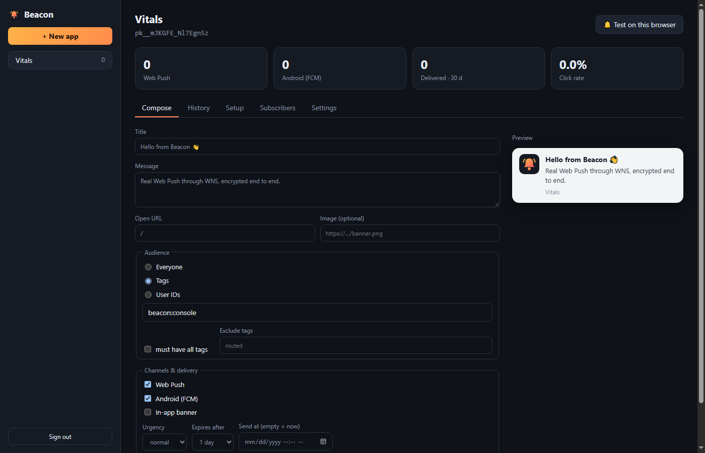

# Beacon

**Self-hosted push notifications for all your apps: Web Push, native Android (FCM) and in-app messages, with a console and an MCP server for AI agents.**

It's a zero-dependency, self-hosted take on services like [PushNotif](https://pushnotif.biz.id) and OneSignal: no per-message fees and no third-party SDK, and the subscriber data stays on your server. It reuses the standards-verified Web Push crypto from Orbis (`apps/orbis/server/webpush.py`), so every PWA in this repo (Vitals, Glow, Mint, Guangyao…) can share one push backend.



| | |
| --- | --- |
| **Web Push** | Chrome, Edge, Firefox, Safari, and iOS 16.4+ when installed to the Home Screen. VAPID (RFC 8292) and aes128gcm encryption (RFC 8291), in pure Python. |
| **Native Android** | Capacitor apps with `@capacitor/push-notifications` register an FCM token, and Beacon sends via the FCM HTTP v1 API. Auth uses an RS256 service-account JWT, also in the stdlib. |
| **In-app messages** | `Beacon.inApp()` shows banners inside your app, either broadcast or per user. |
| **Targeting** | Everyone, tags (`any` / `all`), user IDs, or excluded tags. |
| **Scheduling** | `send_at` (ISO 8601 with offset) or `delay_seconds`. Queued messages can be cancelled. |
| **Stats** | Targeted, delivered, failed and pruned counts, plus *shown* and *clicked* reported by the service worker. Tracking is HMAC-signed. |
| **Hygiene** | Dead subscriptions (410/404, FCM `UNREGISTERED`) are pruned automatically. 429/5xx responses are retried. |
| **Multi-app** | One server, many apps. Each has its own VAPID keys, a public `pk_` key and a secret `sk_` key. |
| **Console** | Compose with a live preview, history, setup snippets, subscribers, settings, and a "Test on this browser" button. |
| **MCP** | `list_apps`, `create_app`, `send_notification`, `list_messages`, `app_stats`, `cancel_message`, `integration_snippet`. |

## Run

```bash
python apps/beacon/server/server.py --public-url https://push.example.com
# first start prints:  ADMIN TOKEN (shown once, keep it safe): adm_…
```

Open the console at `/`, paste the admin token, and create an app. **Browsers only allow push from HTTPS pages**, so in production put Beacon behind TLS. Step-by-step Cloudflare Tunnel and Docker + Caddy recipes are in [docs/DEPLOY.md](docs/DEPLOY.md). For local testing, use Push Lab (`apps/pushlab/start-push-lab.bat`).

**Share a subscribe link:** `https://push.example.com/try/?app=pk_…&tags=beta` is a ready-made page where anyone can opt in with one tap. It's handy for beta testers and QA phones.

Options: `--port 8780`, `--data beacon-data/beacon.db`, `--workers 16`, `--admin-token` / `BEACON_ADMIN_TOKEN`, `--reset-admin-token`.
If the server can only reach the internet through a proxy, set `BEACON_PROXY=http://proxy:3128`. The system proxy is used automatically; set `BEACON_PROXY=none` to turn that off.

## Add to a web app (2 lines + 1 line)

```html
<script src="https://push.example.com/beacon.js"></script>
<script>
  Beacon.init({ server: "https://push.example.com", appKey: "pk_…" });
  enableButton.onclick = () => Beacon.subscribe({ userId: user.id, tags: ["lang:id"] });
  Beacon.inApp();               // optional in-app banners
</script>
```

Add this as the first line of your existing `sw.js`, with `beacon-sw.js` copied next to it:

```js
importScripts('beacon-sw.js');
```

`beacon-sw.js` only handles Beacon messages. Your app's own push handlers, such as Orbis chat, keep working.

Other client calls are `Beacon.identify({ userId, tags })` after login, `Beacon.unsubscribe()`, `Beacon.inbox()` and `Beacon.permission()`. `Beacon.needsInstallOnIOS()` tells you when to show an "Add to Home Screen" hint.

## Native Android (Capacitor)

1. Install the plugin: `npm i @capacitor/push-notifications`, add `google-services.json`, then run `npx cap sync`.
2. In Firebase, go to **Project settings → Service accounts → Generate new private key**, and paste the JSON into the console under **Settings**.
3. In the app, `Beacon.subscribe()` detects Capacitor and registers the FCM token automatically.

## Send from a backend, cron job or CI

```bash
curl -X POST https://push.example.com/v1/send \
  -H "Authorization: Bearer sk_…" -H "Content-Type: application/json" \
  -d '{"title":"Weekly report ready","body":"Tap to see it","url":"/report",
       "target":{"tags":["plan:pro"]},"channels":["webpush","fcm","inapp"],
       "send_at":"2026-11-03T09:00:00+07:00"}'
```

| Endpoint | Auth | |
| --- | --- | --- |
| `POST /v1/send` | `sk_` or admin + `app_id` | queue or schedule a notification |
| `GET /v1/messages`, `GET /v1/messages/{id}`, `POST /v1/messages/{id}/cancel` | `sk_` / admin | history and stats |
| `GET /v1/stats?days=30` | `sk_` / admin | totals and subscribers per channel |
| `GET/POST /v1/apps…` | admin | create apps, update settings, rotate secrets, list subscribers |
| `POST /v1/subscribe`, `/v1/register-device`, `/v1/update`, `/v1/unsubscribe`, `GET /v1/inbox`, `POST /v1/track` | public (`pk_`) | used by `beacon.js` / `beacon-sw.js` |

## More channels: ntfy, Bark, Gotify and Apprise

Besides Web Push, FCM and in-app, a subscriber can be a **contact**:

- **ntfy** ([ntfy.sh](https://github.com/binwiederhier/ntfy), Apache-2.0) — anyone with the free ntfy app
  subscribed to the topic gets the notification. Zero dependencies. Hosts are allow-listed
  (`BEACON_NTFY_HOSTS`, default `ntfy.sh`); protected topics take an access token (`secret`).
- **Bark** ([Finb/Bark](https://github.com/Finb/Bark), MIT) — native iPhone notifications through APNs with
  no Apple developer account: paste the device URL the Bark app shows (`https://api.day.app/<device_key>`).
  Urgency maps to iOS levels (`high` → time-sensitive, `low` → passive). Self-hosted
  [bark-server](https://github.com/Finb/bark-server): add its host to `BEACON_BARK_HOSTS`.
- **Gotify** ([gotify/server](https://github.com/gotify/server), MIT) — your own push server with an Android app.
  Address = server URL, `secret` = the Gotify app token. Gotify is always self-hosted, so its hosts must be
  listed in `BEACON_GOTIFY_HOSTS` before contacts can be added.
- **Apprise** ([caronc/apprise](https://github.com/caronc/apprise), BSD-2) — Telegram, Slack, Discord, Teams,
  email, Pushover, Gotify and 100+ more, one URL per contact. Optional: `pip install apprise` on the server.

Contacts are added from the console (Subscribers → *+ Add contact*), the `add_contact` MCP tool, or a backend:

```bash
curl -X POST $BEACON/v1/contacts -H "Authorization: Bearer sk_…" -H "Content-Type: application/json" \
  -d '{"channel":"ntfy","address":"https://ntfy.sh/my-team-alerts","tags":["team"]}'
curl -X POST $BEACON/v1/contacts -H "Authorization: Bearer sk_…" -H "Content-Type: application/json" \
  -d '{"channel":"apprise","address":"tgram://BOTTOKEN/CHATID","tags":["oncall"]}'
curl -X POST $BEACON/v1/contacts -H "Authorization: Bearer sk_…" -H "Content-Type: application/json" \
  -d '{"channel":"bark","address":"https://api.day.app/DEVICEKEY","tags":["oncall"]}'
curl -X POST $BEACON/v1/contacts -H "Authorization: Bearer sk_…" -H "Content-Type: application/json" \
  -d '{"channel":"gotify","address":"https://push.example.com","secret":"APPTOKEN","tags":["ops"]}'
```

Only app secrets / the admin token can add contacts (never the public subscribe API), and contact URLs are
masked in listings because they often embed tokens (Bark keys, Gotify tokens). Messages go to all push channels by default
(`webpush`, `fcm`, `ntfy`, `bark`, `gotify`, `apprise`); pass `channels` to narrow it.

## Workflows: digest and fallback

Two Novu-style workflow features, set per message on `POST /v1/send` (and the MCP `send_notification` tool):

```bash
# Digest: sends with the same key inside the window become ONE notification
curl -X POST $BEACON/v1/send -H "Authorization: Bearer sk_…" -H "Content-Type: application/json" \
  -d '{"title":"Ana commented","url":"/post/42","target":{"user_ids":["u1"]},
       "digest":{"key":"comments:post42:u1","window":600,"title":"{count} new comments"}}'

# Fallback: in-app first; if nobody clicks within an hour, re-send on ntfy
curl -X POST $BEACON/v1/send -H "Authorization: Bearer sk_…" -H "Content-Type: application/json" \
  -d '{"title":"Your invoice is ready","channels":["inapp"],"target":{"user_ids":["u1"]},
       "fallback":{"after":3600,"unless":"clicked","channels":["ntfy"],"title":"Reminder: invoice ready"}}'
```

- **Digest** — the first message waits `window` seconds (1–86400); later sends with the same `key` are folded
  in (response `"digested": true`, same message id). The notification says *"N new …"* (`title` template with
  `{count}`), lists the newest titles in the body, opens the newest item's URL and carries up to 8 items in
  `data.digest`. Make the key per recipient (e.g. include the user id) when targets differ.
- **Fallback** — `after` seconds (1–604800) after the message finishes, Beacon checks its counter
  (`unless`: `clicked` default, `shown`, or `delivered`). If it is still 0, a follow-up goes out on
  `channels` to the same target (`parent_id` / `fallback_id` link both; `fallback_state` is
  `pending → sent | skipped | cancelled`). Cancel with `POST /v1/messages/{id}/cancel-fallback`.
  The condition is per message, not per recipient: one click anywhere counts.

## Uptime alerts from Gatus

[Gatus](https://github.com/TwiN/gatus) (Apache-2.0) checks your endpoints and has a `custom` alert provider.
Point it at `POST /v1/hooks/gatus` with the app secret and every **TRIGGERED** / **RESOLVED** alert becomes a
push on all Beacon channels — ready-made config: [`examples/gatus/config.yaml`](examples/gatus/config.yaml).

- Down → high urgency `🔴 core / api is down` (description + errors); recovered → `✅ core / api is back up`.
  Both share the tag `gatus:<group>-<name>`, so the recovery replaces the alert on the device, and a RESOLVED
  alert **cancels any pending escalation** of that endpoint.
- Routing lives in the hook URL: `tags=oncall`, `users=alice`, `channels=bark,ntfy`, `page=<status page>`,
  `escalate_after=600&escalate_channels=bark` (re-send if nobody taps), `digest=120` (one push per alert storm),
  `resolved=operational` (custom placeholder words).
- Gatus fills its template by plain text replacement, so names or conditions with quotes produce broken JSON;
  Beacon reads those bodies leniently instead of rejecting the alert.

## Go live (public HTTPS in one click)

Console → **🌍 Go live** (or `server.py --tunnel`, or `POST /v1/tunnel/start` with the admin token) downloads
[cloudflared](https://github.com/cloudflare/cloudflared) (Apache-2.0) into `apps/beacon/tools/` once and opens a
Cloudflare quick tunnel: Beacon gets a random `https://….trycloudflare.com` address, phones anywhere can open the
`/try/` subscribe page, and click tracking switches to the public URL. Rate limits use the real visitor IP
(`CF-Connecting-IP`, trusted only while the tunnel is up). Quick tunnels are for testing (no uptime
guarantee) — use [docs/DEPLOY.md](docs/DEPLOY.md) for production. Behind corporate firewalls that block direct
connections to Cloudflare the console says so; quick tunnels can't use an HTTP proxy.

## AI agents (MCP)

```json
{
  "mcpServers": {
    "beacon": {
      "command": "python",
      "args": ["C:/…/apps/beacon/server/mcp_server.py"],
      "env": { "BEACON_URL": "https://push.example.com", "BEACON_ADMIN_TOKEN": "adm_…" }
    }
  }
}
```

Example prompt: *"Remind every Vitals user tagged lang:id tomorrow at 9:00 WIB to check their battery report."*

## Test it on a real phone

Pair Beacon with [Tether](../tether#push-qa-with-beacon) to check that pushes actually arrive and open the right page. This works from a flow, from CI, or from an AI agent.

## Security notes

- The admin token, app secrets and subscriber tokens are stored only as SHA-256 hashes.
- VAPID private keys never leave the server, and `beacon.js` only sees the public key.
- Subscription endpoints must be real push services, which guards against SSRF. Keys are checked to be on the P-256 curve.
- You can set allowed origins per app. The public endpoints are rate-limited per IP (`BEACON_RATE_PER_MINUTE`, default 120).
- Payloads are end-to-end encrypted to each browser, so push services can't read them.

## Limits

- Pure-Python crypto runs at about 10 ms per Web Push message per CPU, roughly 100 messages/s on one core. That's plenty for thousands of subscribers. For millions, use a compiled crypto library.
- iOS Web Push only works for PWAs installed to the Home Screen (an Apple rule). Native iOS goes through FCM once your Firebase project has an APNs key.
- No email or SMS channels yet.

## Tests

```bash
python apps/beacon/tests/verify_api.py        # 72 end-to-end checks, no network needed
python apps/beacon/tests/verify_webpush.py    # crypto known-answer vectors (same as Orbis)
python apps/beacon/tests/verify_channels.py   # ntfy + Apprise (40)
python apps/beacon/tests/verify_bark_gotify.py  # Bark + Gotify (36)
python apps/beacon/tests/verify_gatus.py     # Gatus alert hook (28)
python apps/beacon/tests/verify_tunnel.py     # Go live / cloudflared (22)
python apps/beacon/tests/verify_workflows.py  # digest + fallback (23)
```

The end-to-end test runs a fake push service that verifies each VAPID JWT and **decrypts every payload with the browser's private key**, plus fake Google OAuth/FCM endpoints that verify the RS256 signature.
