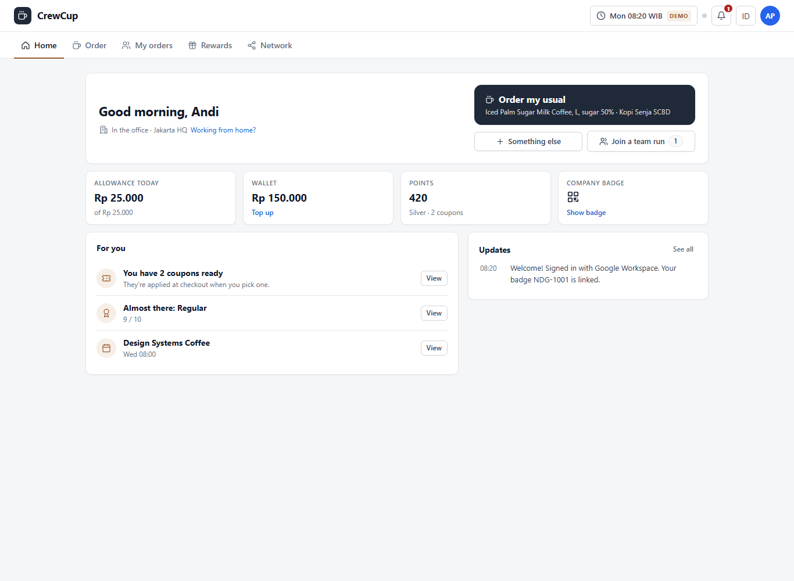
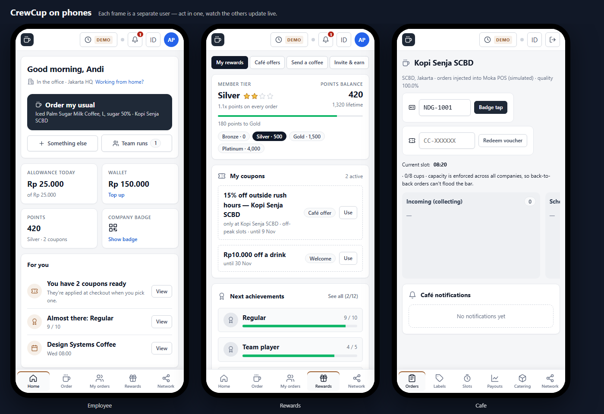

# CrewCup

Office coffee for teams in Indonesia and Southeast Asia: order solo or as a group "coffee run", pay with the company allowance, pick up at partner cafés with your company badge, and earn rewards.





**Status:** working prototype (v0.7). Python standard library only: no pip installs, no build step. 101 tests.

## Run it

```bash
python server.py            # http://localhost:8787
python server.py --reset    # start from fresh demo data
python server.py --lan      # also print a phone URL for the same Wi-Fi
python -m unittest discover -s tests
```

On Windows, double-click `CrewCup.vbs` to open it in its own app window (`stop-crewcup.bat` stops it). Open `http://localhost:8787/preview.html` to see three phones side by side, each a different user, updating live.

## What it does

- **Employees**: one-tap "Order my usual", solo or group coffee runs with a cutoff (everyone's money is held, so the runner never pays upfront), meeting orders from the calendar, company badge QR for pickup, allowance, wallet and QRIS top-ups.
- **Partner cafés**: order board with batching by pickup slot, cup labels with allergy warnings, slots and stock, payouts and forecasts, catering.
- **Company admin / HR**: policy and budgets, spend and tax receipts, runner fairness, engagement, an audit log, and company rewards (send a coffee, nominations, vouchers).
- **CrewCup Network**: see other companies in your building, coffee chats and meetups.
- **Rewards**: points and member tiers, coupons, café offers, achievements and referrals.
- **Everywhere**: English and Bahasa Indonesia, installable PWA, live updates (SSE), local currencies for six SEA countries, Ramadan mode, signed sessions and per-role permissions, SQLite storage.

The original product spec is in [`docs/product-spec.md`](docs/product-spec.md).

## Version history


Installable app (PWA + Windows desktop window) built from the CrewCup spec (`docs/product-spec.md`).
Python standard library only — no pip installs, no build step. See `PLAN.md` for what was done and what's next.

## Open the app
| Where | How |
|---|---|
| **Windows desktop app** | Double-click `CrewCup.vbs` → starts the server in the background and opens CrewCup in its own app window. `stop-crewcup.bat` stops it. Optional Start-menu entry: `powershell -ExecutionPolicy Bypass -File add-start-menu-shortcut.ps1` |
| **Install as an app (PWA)** | Open http://localhost:8787 in Edge/Chrome → **📲 Install app** in the top bar (or the browser's ⊕ install icon). Gets its own icon, window, offline shell and notifications. |
| **Phones on the same Wi-Fi** | `python server.py --lan` prints a phone URL. Over plain LAN HTTP it runs as a web page; installing on phones needs HTTPS (deploy behind a TLS domain). |
| **Console / dev** | `start-demo.bat` or `python server.py [--reset] [--port 8787]` |

## What's new in v0.3
- **Scannable QR codes** everywhere (badge, "scan to join" on group runs, guest & top-up payment) — own encoder, verified with OpenCV.
- **Top-ups like a real gateway**: create charge → QRIS-format QR (EMVCo + CRC) → "Simulate: customer paid" fires the provider webhook → wallet credited once.
- **Sign-in sessions + permissions**: the server now checks every action (you can only order for yourself; cafés only touch their own tickets; admins only for policy).
- **SQLite database + Audit log** tab for admins (data in `data/crewcup.db`).

## What was new in v0.2
- **Installable PWA**: manifest, icons (incl. maskable + Apple), service worker with offline app shell, home-screen shortcuts (Order / Runs / Café board).
- **Sign-in screen**: simulated Google Workspace / Microsoft SSO account picker, work-email sign-in, café-partner and admin entry, join-with-code. Sign out with ⎋. The top-bar user switcher stays as a demo tool.
- **Live updates**: Server-Sent Events push every change instantly (green dot = live); the server clock ticks in the background so cutoffs and "ready" happen without anyone refreshing.
- **Notifications**: "Turn on alerts" → system notifications for cup codes, coffee ready, courier at lobby, run opened (when the app is in the background); in-app toasts otherwise.
- **One-tap order**: "My usual" and "Same as last time" on Home: next free slot, allowance applied automatically.
- **Phone layout**: bottom tab bar, touch-sized controls, swipeable café board, bottom-sheet dialogs.
- **Server hardening**: JSON 500s instead of crashes, request-size limit, security headers, local-only shutdown, health endpoint.
- **Tests**: 39 engine + 6 HTTP/API tests (`python -m unittest discover -s tests`).

## 5-minute walkthrough
1. Open the app → **Continue with Google Workspace** → pick **Andi Pratama** (Jakarta).
2. Home → **⚡ My usual**: one tap, cup code arrives as a notification.
3. Order tab → type `es kopi susu aren kurang manis sedikit es` → **Understand** → Start a group run → share on WhatsApp.
4. Open a second window (`?persona=cafe:c_senja`) as the café; watch tickets appear live. Toggle **oat milk sold out** → orders auto-substitute.
5. Move the clock (+15m) → cutoff → fire-on-approach → runner scans cups → missing-cup check.
6. Sign out → **Company admin** → Ramadan mode, budgets, CSV expense export, fairness.

## What's simulated
SSO/SCIM, payment gateways (Xendit/Midtrans/QRIS/e-wallets), POS (Moka/Square), couriers (GoSend/Grab), calendars,
desk booking, geofence and badge readers. Tax rates and payment methods are demo assumptions — verify with local
tax advisors and payment partners. Not production-ready: no real auth, single-process JSON storage.

## Layout
- `crewcup/engine.py` business rules · `crewcup/seed.py` demo data · `crewcup/config.py` SEA market config
- `server.py` HTTP API, SSE live updates, background clock, static app
- `static/` app (vanilla JS), `manifest.webmanifest`, `sw.js`, `icons/`
- `CrewCup.vbs`, `stop-crewcup.bat`, `add-start-menu-shortcut.ps1`, `start-demo.bat`
- `tests/` unit + API tests

## v0.4 — CrewCup Network (cross-company)

A professional social layer so people can see and meet the other companies around them:

- **Network tab** (employees, cafés, admins): feed of updates, café announcements, questions and job openings, scoped to *my building*, *my city* or *my company*; like, comment, hide, report.
- **Company directory**: companies in your building/city with verified domain, floors, favourite cafés, aggregate stats (if shared), follow.
- **People & coffee chats**: people who opted in to be visible; invite them to a partner café at a time slot, they accept/decline; add to calendar (.ics).
- **Meetups at partner cafés**: hosted by companies, people or cafés; capacity and a per-company cap so every company gets a seat; RSVP shows counts per company, never names.
- **SCBD Green Cup Challenge**: building leaderboard of reusable-cup rate, only for companies sharing aggregate stats.
- **Privacy & safety** (enforced server-side in `crewcup/social.py → view_for`): company visibility network/building/private, admin kill switch, share-stats toggle, block a company, moderation queue for own employees' posts, auto-hide after 3 reports, per-person profile visibility and coffee-chat permission, post rate limit. Orders, wallets and allowances are never shared across companies.

Seed data (`crewcup/social_seed.py`) adds 7 fictional companies (Bank Mandala, Arunika Health, Lumbung Logistik, Kawan Studio, Samudra Energi [private], Straits Analytics SG, Tropika Games KL) with people, posts, meetups and live replies from the simulated people. Tests: `tests/test_social.py` + network API tests in `tests/test_server.py`.

## v0.5 — Company coffee rewards

The company itself can now give coffee, not just colleagues:

- **Admin → Rewards**: give 1–5 coffees to a person, a team or a whole office with a reason and message; optional shout-out on the company-only Network feed. Paid from a monthly per-office **rewards budget** (shown in Policy & budgets; spend recorded as an individual benefit for tax/export).
- **Automatic rewards**: welcome coffee for SCIM joiners, work-anniversary coffee, birthday coffee for employees who opt in (birthday never shown to anyone).
- **Nominations**: employees nominate a colleague; admins approve (choose coffees) or decline; nominator is notified.
- **Thank a partner**: send coffee to someone at another company on the Network → single-use voucher code (30 days) that any partner café in their city redeems at the counter (café Order board → Redeem voucher). Spend is recorded as *Partner & client coffees*.
- **Employees → Gifts & rewards**: "From the company" history, office recognition wall, nomination form, birthday opt-in. Rewards land as gift credit (allowance → gift credit → wallet).
- Rewards, nominations and vouchers are sent per viewer by the server (`server.py → rewards_view`); others never receive them. Logic in `crewcup/rewards.py`, tests in `tests/test_rewards.py`.

## v0.7 — simpler, friendlier UI

Same features and backend; the employee app is easier to use:

- **Clean header**: logo, a single *Demo* button (switch user, move the simulated clock, reset, sign out, install), notifications bell with unread count, language, and your avatar (opens Profile).
- **5 tabs instead of 7**: Home, Order, My orders (runs + meetings), Rewards, Network. Profile is behind the avatar.
- **Home**: greeting, one big *Order my usual* button, 4 tiles (allowance, wallet, points, badge), max 3 *For you* suggestions, latest 5 updates. Badge and full notifications open as pop-ups.
- **Rewards**: 4 sections (My rewards, Café offers, Send a coffee, Invite & earn). History and "how to earn" fold away; achievements show the next 3 with *See all*.
- **Plainer language** in employee screens (no SCIM/SAML/payment-order jargon); wallet details moved to Profile.
- **Phone layout fixed**: header fits on one line, bottom nav fits all tabs, no sideways scrolling.

Tip: add `&demo=1` to the URL to open the demo drawer on load.

## v0.6 — Loyalty: points, stars, coupons, achievements, referrals

- **Points** from real, completed activity: each paid drink (+10), reusable cup (+5), joining a group run (+5), doing a coffee run (+20 + 2/cup), sending a gift (+5), a coffee chat with another company (+15), joining a meetup (+10), referrals that join (+500 company / +300 café).
- **Star tiers** by lifetime points: Bronze 1★ (0), Silver 2★ (500), Gold 3★ (1,500), Platinum 4★ (4,000) with 1.0/1.1/1.25/1.5× point multipliers and a free-upgrade coupon on each tier-up.
- **Coupons** (percent, amount, free size upgrade, free drink, off-peak only, café-specific) apply to your own drink at order time with a live price preview. CrewCup-funded coupons (points store, achievements, tier gifts) top up the café payout so it is paid in full; **café promotions** are café-funded. A coupon is released if the line is removed before the café starts.
- **12 achievements** (First cup, Regular, Bring your own cup, Café explorer, Team runner, Early bird, Off-peak pro, Connector, Ambassador…) with progress bars, bonus points and coupons.
- **Refer & earn**: refer another company or a café with a personal code; status goes sent → in conversation → joined, then points + Ambassador.
- **Points store**: 10% off, free upgrade, amount off, free drink, or donate a meal.
- Employee: Gifts & rewards tab (Points & coupons · Achievements · Café offers · Refer & earn · Gifts & recognition), coupon picker on the Order screen, summary card on Home. Café: Network tab → Promotions. Admin: Rewards tab → Loyalty programme summary.
- Server sends each viewer only their own loyalty data (`server.py → loyalty_view`). Logic in `crewcup/loyalty.py`, tests in `tests/test_loyalty.py`.
