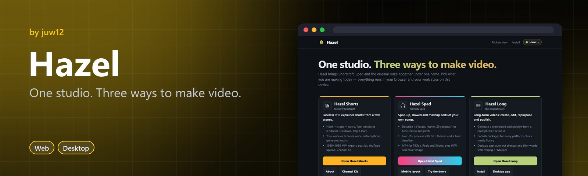
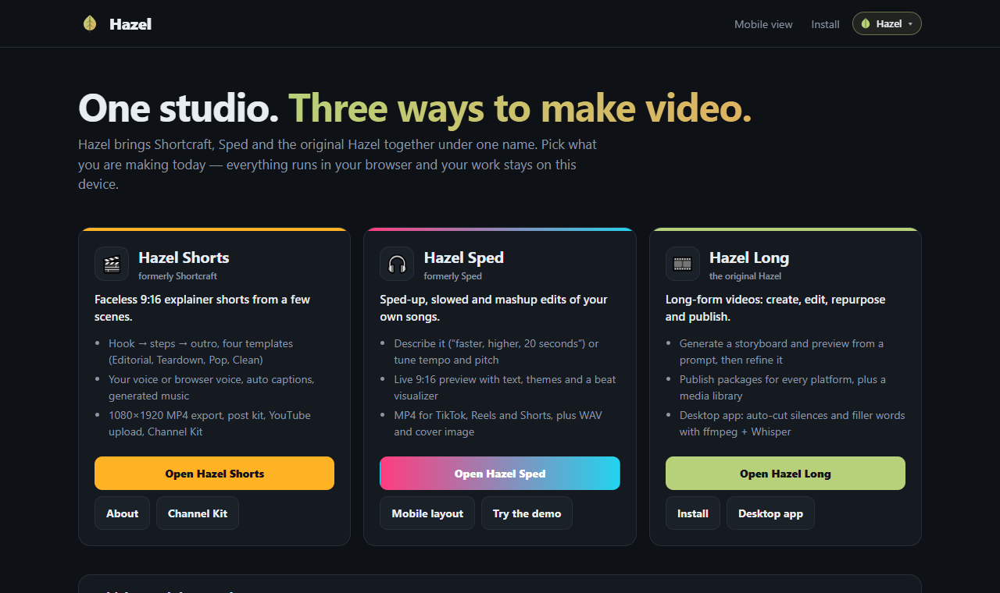

<!-- HERO:START -->
<p align="center">
  <a href="https://juw12.github.io/projects/hazel/"></a>
</p>

<p align="center">
  <b>One studio. Three ways to make video.</b><br>
  Hazel Shorts, Hazel Sped and Hazel Long, in one creator studio.
</p>

<p align="center">
  <a href="https://juw12.github.io/projects/hazel/"><b>Try it live</b></a> ·
  <a href="#see-it-in-action">See it in action</a> ·
  <a href="#highlights">Highlights</a> ·
  <a href="https://github.com/juw12">More by juw12</a>
</p>

<p align="center">
  <a href="https://github.com/juw12/projects/tree/main/apps/hazel"></a>
  <a href="https://juw12.github.io/projects/hazel/"></a>
  
  
  
</p>

<a id="highlights"></a>
<table>
  <tr>
    <td width="33%" valign="top">
      <b>Hazel Shorts</b><br>
      Faceless explainer shorts from a script.
    </td>
    <td width="33%" valign="top">
      <b>Hazel Sped</b><br>
      Sped-up and mashup edits of your songs.
    </td>
    <td width="33%" valign="top">
      <b>Hazel Long</b><br>
      Create, cut and publish long-form video.
    </td>
  </tr>
</table>

## See it in action

<p align="center">
  <a href="https://juw12.github.io/projects/hazel/"></a><br>
  <sub>Open the interactive demo at <a href="https://juw12.github.io/projects/hazel/">juw12.github.io/projects/hazel/</a></sub>
</p>
<!-- HERO:END -->

## About

**One creator studio, three apps.** Hazel brings Shortcraft, Sped and the original Hazel together under one name,
one home page and one switcher (the leaf chip at the top of every Hazel page).

| App | What it makes | Formerly | Web | Source |
| --- | --- | --- | --- | --- |
| **Hazel Shorts** | Faceless 9:16 explainer shorts: scenes, voice, captions, generated music, MP4 export, post kit, Channel Kit, YouTube upload | Shortcraft | [`hazel/shorts/`](https://juw12.github.io/projects/hazel/shorts/app.html) | [`web/shorts`](web/shorts/), [`shorts/`](shorts/) (pipeline, autoposter, docs) |
| **Hazel Sped** | Sped-up, slowed and mashup edits of your own songs as 9:16 MP4s; works offline | Sped (and Hookline before that) | [`hazel/sped/`](https://juw12.github.io/projects/hazel/sped/) | [`web/sped`](web/sped/), [`sped/`](sped/) (docs, browser tools) |
| **Hazel Long** | Long-form studio: create from a prompt, edit, repurpose, publish; Windows desktop app auto-cuts silences and filler words | the original Hazel | [`hazel/long/`](https://juw12.github.io/projects/hazel/long/) | [`web/long`](web/long/), [`long/`](long/) (Electron desktop app) |

**Live:** https://juw12.github.io/projects/hazel/ (Hazel home · [mobile](https://juw12.github.io/projects/hazel/mobile.html) · [install](https://juw12.github.io/projects/hazel/app.html))

## Layout

```
apps/hazel/
  web/                 deployed to /projects/hazel/
    index.html         Hazel home (pick an app, "continue where you left off")
    mobile.html        Hazel home, mobile entry points
    app.html           install Hazel (manifest shortcuts into each app)
    hazel-switch.css   the shared switcher (byte-identical copies in each app folder below)
    hazel-switch.js
    sw.js              retires the pre-Hazel worker at this address (deletes only 'hazel-app-*' caches)
    shorts/            Hazel Shorts web studio
    sped/              Hazel Sped web app (own offline worker, cache 'hazel-sped-v…')
    long/              Hazel Long web studio (own offline worker, cache 'hazel-long-v…')
  shorts/              Hazel Shorts pipeline (render, voice, autopost) + docs
  sped/                Hazel Sped docs + headless-browser tools
  long/                Hazel Long desktop app (Electron + ffmpeg + Whisper)
  tests/               test_hazel.py, test_shorts_static_integrity.py, test_sped.py, test_sped_branding.py
```

## Moving over from the old apps

- **Old links redirect:** `/projects/shortcraft/…` → `hazel/shorts/…`, `/projects/sped/…` and `/projects/hookline/…` →
  `hazel/sped/…` (query strings such as `?sample=` and `?demo=` are kept). `/projects/hazel/` itself is now Hazel home;
  the old Hazel web studio is at `hazel/long/`.
- **Your work is still there:** all three apps live on the same site, and their browser storage names were kept on
  purpose (`shortcraft.project.v1`, the `shortcraft` voice-clip database, `sped-look`, `hazel-studio-v1`, …), so
  projects, voice clips, looks and settings open as before. Recipe files from Sped and Hookline still load.
- **Offline workers:** the old Sped worker (`/projects/sped/`) and the old Hazel worker are retired and clear only their
  own caches. The old Hazel worker used to delete *every* cache on the site (other apps' offline data included); its
  replacement in Hazel Long only touches `hazel-long-v…` caches.
- **Desktop app:** the window and shortcut are now "Hazel Long"; its data folder, `~/Videos/Hazel` export folder,
  settings and taskbar identity are unchanged.

## Run locally

```bash
python -m http.server 8000 --directory apps/hazel/web
# Hazel home   http://localhost:8000/
# Shorts       http://localhost:8000/shorts/app.html
# Sped         http://localhost:8000/sped/
# Long         http://localhost:8000/long/
```

Desktop app: see [long/README.md](long/README.md).

## Tests

```bash
python apps/hazel/tests/test_hazel.py                   # hub, switcher, catalog, redirects, workers
python apps/hazel/tests/test_shorts_static_integrity.py # Hazel Shorts
python apps/hazel/tests/test_sped.py                    # Hazel Sped static + engine (needs node for the engine part)
python apps/hazel/tests/test_sped_branding.py           # Hazel Sped naming, legacy recipes and redirects
python scripts/run_all_tests.py                         # everything in apps/*/tests
```
