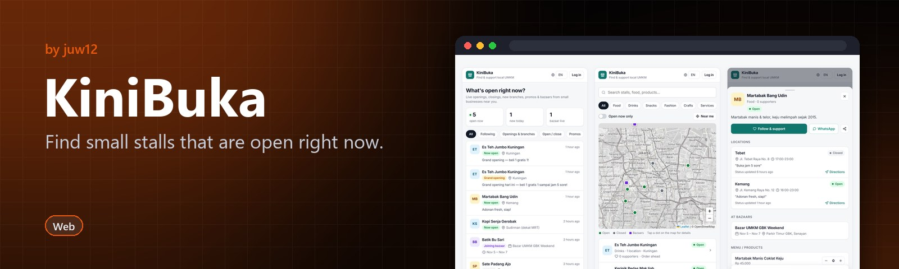

<!-- HERO:START -->
<p align="center">
  <a href="https://github.com/juw12/projects/tree/main/apps/kinibuka"></a>
</p>

<p align="center">
  <b>Find small stalls that are open right now.</b><br>
  A live feed of Indonesian UMKM openings, closings, promos and bazaars.
</p>

<p align="center">
  <a href="#see-it-in-action">See it in action</a> ·
  <a href="#highlights">Highlights</a> ·
  <a href="https://github.com/juw12">More by juw12</a>
</p>

<p align="center">
  <a href="https://github.com/juw12/projects/tree/main/apps/kinibuka"></a>
  
  
</p>

<a id="highlights"></a>
<table>
  <tr>
    <td width="33%" valign="top">
      <b>Live open status</b><br>
      See which stalls are open now on a feed and a searchable map.
    </td>
    <td width="33%" valign="top">
      <b>Follow alerts</b><br>
      Follow your favourites and hear when they open or post a promo.
    </td>
    <td width="33%" valign="top">
      <b>Order ahead</b><br>
      A one-tap WhatsApp handoff to the seller.
    </td>
  </tr>
</table>

## See it in action

<p align="center">
  <a href="https://github.com/juw12/projects/tree/main/apps/kinibuka"></a><br>
  <sub>KiniBuka in use</sub>
</p>
<!-- HERO:END -->

## About

**Kini buka** means "open now". KiniBuka helps people find small Indonesian food and retail stalls (UMKM) that are open right now, follow the ones they like, and order ahead.


## Features

**For buyers**
- **Latest feed:** live list of stalls opening and closing, new branches, promos and bazaars
- **Explore:** search, category filters and an OpenStreetMap map of stalls that are open now
- **3D market:** switch Explore from Map to 3D and walk a street of the stalls in your current search. Tap the ground to walk, tap a stall to go to it, drag to look around, pinch or scroll to zoom. Open stalls are lit and stocked, closed ones are shuttered
  - Every stall shows its menu on a chalkboard, and the card under the view lists the whole menu with prices (tap an item to order)
  - Live and upcoming bazaars stand as purple tents at the end of the street, with their dates and the stalls taking part
  - Any number of stalls: only the rows near you are built, and far stalls make your avatar jog
  - Your spot is kept when you switch language, leave Explore or reload; standing between two stalls offers both
- **Follow:** get alerts when a followed stall opens, posts a promo or joins a bazaar
- **Order ahead:** pick items and a pickup time, then track the order as the seller accepts (or rejects) it, marks it ready and completes it
- **WhatsApp:** one-tap buttons to chat with the seller or send the order details
- **Deep links:** `#stall/<id>` opens a stall, `#3d` opens the 3D market, and `?lang=en` sets the language

**For sellers**
- Toggle open or closed in one tap, per branch
- Manage branches, menu, promos and bazaar appearances
- See incoming orders and update their status
- Optional automatic WhatsApp notifications (see below)

**Languages:** Bahasa Indonesia (default), English and 中文. Each user's choice is remembered.

## Run it

Python 3 with the standard library only. No packages to install.

```
run.bat                 (Windows: starts the server and opens the browser)
python server.py        (any OS; then open http://localhost:8000)
python server.py --open (also opens the browser)
```

If port 8000 is busy, the server picks the next free port and prints it. Set `PORT` to choose one yourself. Data is stored in `kinibuka.db` (SQLite) next to `server.py` (`KINIBUKA_DB` picks another file), and demo data is seeded into an empty database unless `SEED_DEMO=0`.

**Demo logins** (all use the password `demo1234`; the login sheet has one-tap buttons):

| Role   | Phone        |
|--------|--------------|
| Seller | 081111111111 |
| Buyer  | 081333333333 |
| Admin  | 080000000000 |
| New seller waiting for approval | 081444444444 |

## Accounts, stalls and the admin

- **Everyone signs up** with name, WhatsApp number and a password (at least 8 characters). Passwords are stored as PBKDF2-SHA256 hashes; 10 wrong tries for one number in 15 minutes blocks that number for a while. Changing the password (Account) logs out other phones. Accounts from the old phone-only login are claimed by signing up once with the same number.
- **Sellers** open *My Stall*, create the stall, then add locations, menu and posts. A new stall is **pending**: only the seller and the admin can see it. A banner tells the seller the state (waiting, live until a date, ended, rejected or paused, with the admin's note).
- **The admin** is any account whose number is in `ADMIN_PHONES` (comma-separated, e.g. `ADMIN_PHONES=081234567890`). The *Admin* tab shows the slots used out of the market capacity, every stall with its owner, and buttons to approve (with a "show until" date), extend, reject or pause. Approving needs a free slot. When the date passes the stall hides itself from customers (map, list, 3D market, feed, bazaars, orders) until the admin extends it. Capacity (default 50) and the default slot length (30 days) are set in the same tab. The admin can also set a temporary password for a seller who forgot theirs.

## Put it online (Cloudflare Tunnel from this PC)

1. Install cloudflared once: `winget install --id Cloudflare.cloudflared`
2. Double-click `online.bat`. The first time it asks for your WhatsApp number (that number becomes the admin). It starts the server with **no demo data** and a separate database `data/kinibuka-live.db`, then prints an `https://<random>.trycloudflare.com` address.
3. Open that address, sign up with your admin number, and share the address with sellers and customers.

Things to know:

- The PC must stay on and `online.bat` must stay open; closing it takes the market offline.
- The quick-tunnel address changes every time you start it. For a permanent address you need a free Cloudflare account and a domain on Cloudflare: `cloudflared tunnel login`, `cloudflared tunnel create kinibuka`, `cloudflared tunnel route dns kinibuka market.yourdomain.com`, then run `cloudflared tunnel run --url http://localhost:8765 kinibuka` instead of the quick tunnel. (A `pages.dev` address cannot point to a tunnel.)
- `online.bat` uses port 8765; if that port is taken the server moves to the next one and the tunnel will not reach it, so close whatever uses 8765.
- Back up `data/kinibuka-live.db` regularly (copy the file while the server is stopped).
- On an office or company network, check that running a public tunnel is allowed before you do it.

## WhatsApp auto-notifications (optional)

Without configuration, WhatsApp works through `wa.me` links that the user taps. To have the server send messages automatically, set one of the following:

| Provider | Environment variables |
|----------|-----------------------|
| [Fonnte](https://fonnte.com) | `WA_PROVIDER=fonnte`, `FONNTE_TOKEN` |
| Meta WhatsApp Cloud API | `WA_PROVIDER=meta`, `WA_TOKEN`, `WA_PHONE_NUMBER_ID`, optional `WA_TEMPLATE` and `WA_TEMPLATE_LANG` (default `id`) |

`APP_NAME` changes the displayed brand name (default `KiniBuka`).

## Prototype limits

- Login is phone + password with no SMS/WhatsApp verification, so anyone can sign up with any number; the admin approval step is what keeps fake stalls off the market. There is no self-service password reset (the admin sets a temporary one).
- No online payments: buyers pay at the stall (cash or QRIS) on pickup.
- Single-process server with SQLite. It is fine for a demo or one neighbourhood, but not for production scale.
- Map tiles come from the public OpenStreetMap tile server, which is meant for light use only.
- The 3D market needs WebGL; without it the app falls back to the map with a short message.

## Files

- `server.py`: HTTP server, JSON API, SQLite schema and demo seed data
- `static/index.html`: the whole web app (no build step)
- `static/i18n.js`: ID / EN / 中文 strings
- `static/world.js`: the walkable 3D market (loaded only when the 3D view is opened)
- `static/vendor/`: three.js r160 (MIT), vendored so the 3D view works without a CDN
- `run.bat`: Windows launcher (demo data, this PC and the local Wi-Fi)
- `online.bat`: real market on the internet through a Cloudflare quick tunnel (no demo data, own database)
