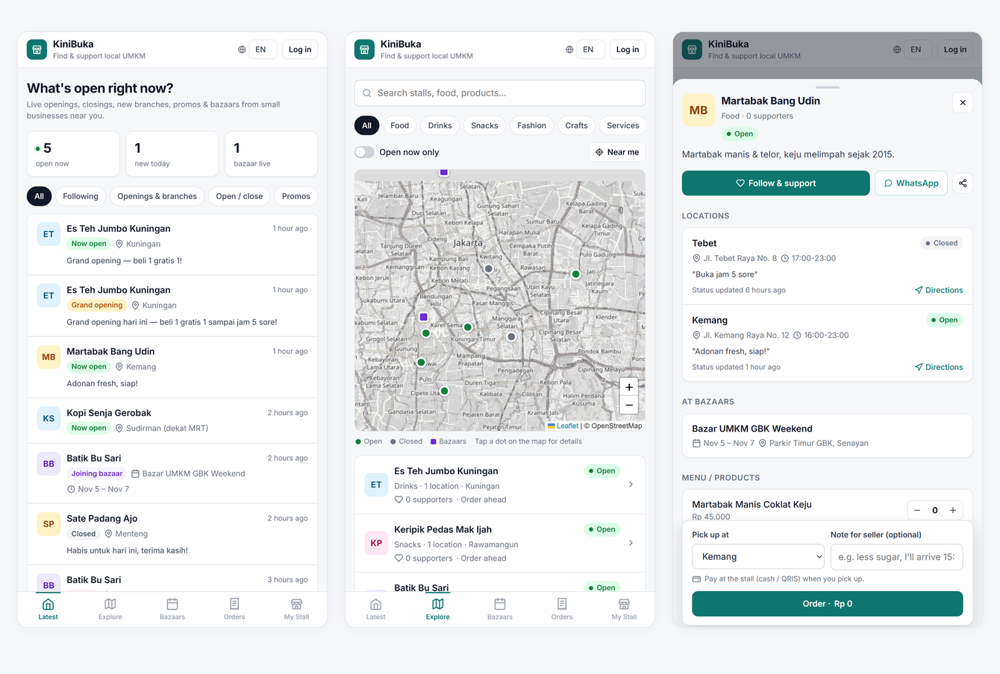

# KiniBuka

**Kini buka** means "open now". KiniBuka helps people find small Indonesian food and retail stalls (UMKM) that are open right now, follow the ones they like, and order ahead.



## Features

**For buyers**
- **Latest feed:** live list of stalls opening and closing, new branches, promos and bazaars
- **Explore:** search, category filters and an OpenStreetMap map of stalls that are open now
- **Follow:** get alerts when a followed stall opens, posts a promo or joins a bazaar
- **Order ahead:** pick items and a pickup time, then track the order as the seller accepts (or rejects) it, marks it ready and completes it
- **WhatsApp:** one-tap buttons to chat with the seller or send the order details
- **Deep links:** `#stall/<id>` opens a stall, and `?lang=en` sets the language

**For sellers**
- Toggle open or closed in one tap, per branch
- Manage branches, menu, promos and bazaar appearances
- See incoming orders and update their status
- Optional automatic WhatsApp notifications (see below)

**Languages:** Bahasa Indonesia (default), English and 中文. Each user's choice is remembered.

## Run it

Python 3 with the standard library only. No packages to install.

```
run.bat                 (Windows: starts the server and opens the browser)
python server.py        (any OS; then open http://localhost:8000)
python server.py --open (also opens the browser)
```

If port 8000 is busy, the server picks the next free port and prints it. Set `PORT` to choose one yourself. Data is stored in `kinibuka.db` (SQLite) next to `server.py`, and demo data is seeded on first run.

**Demo logins** (phone number only, no password in the prototype):

| Role   | Phone        |
|--------|--------------|
| Seller | 081111111111 |
| Buyer  | 081333333333 |

## WhatsApp auto-notifications (optional)

Without configuration, WhatsApp works through `wa.me` links that the user taps. To have the server send messages automatically, set one of the following:

| Provider | Environment variables |
|----------|-----------------------|
| [Fonnte](https://fonnte.com) | `WA_PROVIDER=fonnte`, `FONNTE_TOKEN` |
| Meta WhatsApp Cloud API | `WA_PROVIDER=meta`, `WA_TOKEN`, `WA_PHONE_NUMBER_ID`, optional `WA_TEMPLATE` and `WA_TEMPLATE_LANG` (default `id`) |

`APP_NAME` changes the displayed brand name (default `KiniBuka`).

## Prototype limits

- Phone-number login has no OTP or password. Do not expose it to the internet as is.
- No online payments: buyers pay at the stall (cash or QRIS) on pickup.
- Single-process server with SQLite. It is fine for a demo or one neighbourhood, but not for production scale.
- Map tiles come from the public OpenStreetMap tile server, which is meant for light use only.

## Files

- `server.py`: HTTP server, JSON API, SQLite schema and demo seed data
- `static/index.html`: the whole web app (no build step)
- `static/i18n.js`: ID / EN / 中文 strings
- `run.bat`: Windows launcher
