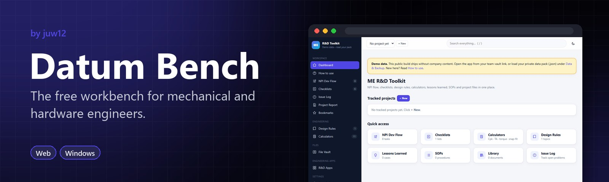
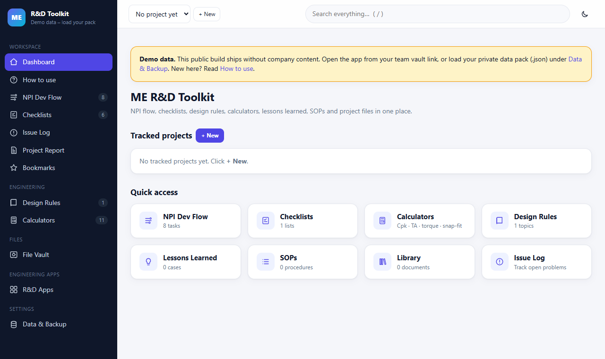

<!-- HERO:START -->
<p align="center">
  <a href="https://juw12.github.io/projects/me-rd-toolkit/index.html"></a>
</p>

<p align="center">
  <b>The free workbench for mechanical and hardware engineers.</b><br>
  NPI task flow, review checklists, an issue log and 11 engineering calculators in one place.
</p>

<p align="center">
  <a href="https://juw12.github.io/projects/me-rd-toolkit/index.html"><b>Try it live</b></a> ·
  <a href="https://github.com/juw12/projects/releases/tag/me-rd-toolkit"><b>Download</b></a> ·
  <a href="#see-it-in-action">See it in action</a> ·
  <a href="#highlights">Highlights</a> ·
  <a href="https://github.com/juw12">More by juw12</a>
</p>

<p align="center">
  <a href="https://github.com/juw12/projects/tree/main/apps/me-rd-toolkit"></a>
  <a href="https://github.com/juw12/projects/releases/tag/me-rd-toolkit"></a>
  <a href="https://juw12.github.io/projects/me-rd-toolkit/index.html"></a>
  
  
  
</p>

<a id="highlights"></a>
<table>
  <tr>
    <td width="33%" valign="top">
      <b>Built around NPI</b><br>
      A task flow and design-review checklists that follow a real product launch.
    </td>
    <td width="33%" valign="top">
      <b>11 calculators</b><br>
      Including tolerance stack-ups, ready for the design review.
    </td>
    <td width="33%" valign="top">
      <b>Datum CAD inside</b><br>
      The flagship: turn a PRD and six photos into a validated STEP model.
    </td>
  </tr>
</table>

## See it in action

<p align="center">
  <a href="https://juw12.github.io/projects/me-rd-toolkit/index.html"></a><br>
  <sub>Open the interactive demo at <a href="https://juw12.github.io/projects/me-rd-toolkit/index.html">juw12.github.io/projects/me-rd-toolkit/index.html</a></sub>
</p>
<!-- HERO:END -->

## About

**Datum Bench** is the free workbench for mechanical and hardware engineers — the companion to
**[Datum CAD](photo2cad/)** (PRD + photos → a validated STEP solid). Formerly the *ME R&D Toolkit*.
Part of **Datum**.

Offline-first workspace for mechanical R&D: NPI task flow, review checklists, issue log,
project report, engineering calculators and an optional LAN file vault. It runs from a
static web folder with no build step and no third-party dependencies.

The public build ships with **generic demo content only**. Real checklists, rules, limits and
file indexes live in a private *data pack* that is loaded at runtime and never committed.

## Features

- **NPI flow**: phase timeline, per-task status, owner, remarks, milestone dates and overdue warnings
- **Checklists**: OK / NG / NA per item with remarks, category filters, CSV export and print
- **Issue log and one-page project report** (NG items, failed checks, open issues)
- **Calculators**: Cpk / gap-step, button gap (x̄ − 3σ), screw torque window, tolerance stack-up
  (worst case + RSS), snap-fit cantilever, thermal pad compression, cable bend radius,
  enclosure openings (IEC), colour ΔE, test margin and unit conversion. Limits are editable and
  can be preset from the data pack.
- **File Vault** (optional): browse shared folders by category, search, open or download files
- **Engineering apps**: three sub-apps embedded as sections under **R&D Apps** — **Vertex** (offline CAD
  copilot: diagnose/repair broken models, plan assemblies), **Photo2CAD** (PRD + six reference photos → a
  validated STEP CAD model, written by the MAAS LLM) and **PTB RDME** (the PTB RD ME team's overtime
  submission + Outlook drafts). The Windows app starts their local servers and embeds them live; on the
  static build Vertex falls back to its deployed offline copy and Photo2CAD needs its own server
  (`photo2cad/start.ps1`)
- Bookmarks, recent items, dark mode, built-in "How to use" guide; installable PWA that works offline

## Layout

```
apps/me-rd-toolkit/
  web/       static front-end (deployed to GitHub Pages)
  server/    optional stdlib-only vault server + example config
  vertex/    Vertex sub-app (CAD copilot PWA + stdlib bridge), embedded as a section
  ptb-rdme/  PTB RDME sub-app (overtime/Outlook widget + stdlib server), embedded as a section
  photo2cad/ Photo2CAD sub-app (PRD + photos -> STEP; MAAS LLM + CadQuery), embedded under R&D Apps
  tests/     hermetic stdlib-only tests
```

## Run

- **Static:** open `web/index.html`, or use the deployed page. Project status is stored in the
  browser (`localStorage`); use **Data & Backup** to export or import it.
- **With a data pack:** **Data & Backup → Import data pack** (JSON). The pack stays in the
  browser's IndexedDB and is never uploaded.
- **Vault server:** copy `server/vault_config.example.json` to `private/vault_config.json`,
  set `roots`, `categories`, `exclude` and `excludeNames`, then run
  `python server/vault_server.py`. A password is generated on first run (user `team`).

Private files are looked up in `apps/me-rd-toolkit/private/` (or `ME_PRIVATE_DIR`) and are
ignored by git: `pack.js` (data pack), `calcs.js` (extra calculators registered through
`APP.addCalcs`) and `aliases.js` (local path aliases).

## Security notes

The vault uses HTTP Basic auth, read-only access, path-traversal checks, a strict
category whitelist, exclusion rules and an access log. Basic auth is not encrypted: keep the
server on a trusted internal network and never expose it to the internet.

## Tests

```
python apps/me-rd-toolkit/tests/test_me_rd_toolkit.py
```
