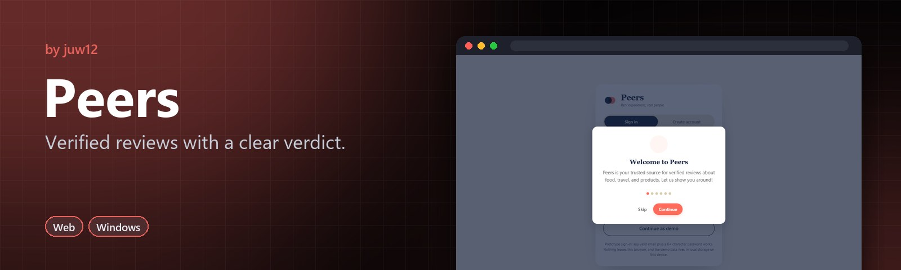
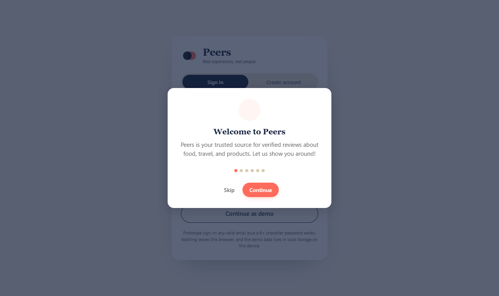

<!-- HERO:START -->
<p align="center">
  <a href="https://juw12.github.io/projects/peers/"></a>
</p>

<p align="center">
  <b>Verified reviews with a clear verdict.</b><br>
  Food, travel, market, AI tools, health and finance reviews in one interface, each with a Use it / Wait / Skip scorecard.
</p>

<p align="center">
  <a href="https://juw12.github.io/projects/peers/"><b>Try it live</b></a> ·
  <a href="https://github.com/juw12/projects/releases/tag/peers"><b>Download</b></a> ·
  <a href="#see-it-in-action">See it in action</a> ·
  <a href="#highlights">Highlights</a> ·
  <a href="https://github.com/juw12">More by juw12</a>
</p>

<p align="center">
  <a href="https://github.com/juw12/projects/tree/main/apps/peers"></a>
  <a href="https://github.com/juw12/projects/releases/tag/peers"></a>
  <a href="https://juw12.github.io/projects/peers/"></a>
  
  
  
</p>

<a id="highlights"></a>
<table>
  <tr>
    <td width="33%" valign="top">
      <b>Verified reviews</b><br>
      Reviews from verified users, across every category.
    </td>
    <td width="33%" valign="top">
      <b>One interface</b><br>
      Every category mode works the same way.
    </td>
    <td width="33%" valign="top">
      <b>A clear verdict</b><br>
      A built-in Use it / Wait / Skip scorecard.
    </td>
  </tr>
</table>

## See it in action

<p align="center">
  <a href="https://juw12.github.io/projects/peers/"></a><br>
  <sub>Open the interactive demo at <a href="https://juw12.github.io/projects/peers/">juw12.github.io/projects/peers/</a></sub>
</p>
<!-- HERO:END -->

## About

Peers is a client-side photo demo application that showcases a responsive photo gallery interface. The app is built as a **single-file HTML** with all CSS and JavaScript embedded inline, requiring no build process or backend server to run.

## Quick Start

**Desktop:** Double-click `web/index.html`  
**Mobile:** Double-click `web/mobile.html`

Both files work completely offline in any modern browser.

## Build Variants

| File | Target | localStorage Key |
|------|--------|------------------|
| `web/index.html` | Desktop browsers | `peers_demo_v3` |
| `web/mobile.html` | Mobile browsers | `peers_mobile_v1` |

The two builds are optimized for different screen sizes but share the same core functionality.

## Architecture

- **Single-file design:** All HTML, CSS, and JavaScript are contained within one file per build variant.
- **Client-side only:** No `fetch()` or `XMLHttpRequest` calls. The app does not require a server.
- **Persistence:** Demo data is stored in browser localStorage using the keys shown above.
- **Assets:** Large image assets are embedded as base64 data URIs within the JavaScript.

## Optional Backend (Zero-Dependency Python)

An optional Python stdlib backend provides server-side persistence while keeping the front-end files **byte-pristine** (never modified on disk).

### Run the Backend

```bash
python apps\peers\server\server.py
```

This serves both the API and the static front-end on `http://127.0.0.1:8788/`.

**CLI Options:**
- `--port 8788` — Custom port (default: 8788)
- `--host 127.0.0.1` — Custom host (default: 127.0.0.1)
- `--no-browser` — Do not open browser on start

**Environment:**
- `PEERS_DB` — Override database path (default: `apps\peers\server\data\peers.db`)

### API Endpoints

| Method | Endpoint | Description |
|--------|----------|-------------|
| `GET` | `/api/health` | Health check: `{"status":"ok","app":"peers","version":"1.0"}` |
| `GET` | `/api/state` | Get full state document |
| `PUT` | `/api/state` | Replace entire state (body: JSON object) |
| `POST` | `/api/reset` | Reset to seed state |
| `POST` | `/api/auth/signup` | Create user: `{action:"signup",email,password,name}` |
| `POST` | `/api/auth/signin` | Login: `{action:"signin",email,password}` |
| `POST` | `/api/auth/logout` | Logout: `{action:"logout"}` |
| `OPTIONS` | `/api/*` | CORS preflight (204) |

All responses include `Access-Control-Allow-Origin: *`.

### Serve-Time HTML Injection (Key Design)

The backend **never modifies** `web/index.html` or `web/mobile.html` on disk. Instead, when serving these files:

1. The server reads the HTML file from disk
2. It injects a small `<script>` shim **immediately before** the first `<script>` tag
3. The injected HTML is served to the browser

The shim does two things:

**(a) Hydrate at boot:** Synchronously sets `localStorage.setItem(KEY, <server state>)` before the app's own `loadState()` runs, so the app reads server state on startup.

**(b) Sync on write:** Wraps `Storage.prototype.setItem` and `removeItem` to fire-and-forget `fetch('/api/state', {method:'PUT', ...})` after every localStorage write, keeping the server in sync.

The shim uses the correct localStorage key for each file:
- `index.html` → `peers_demo_v3`
- `mobile.html` → `peers_mobile_v1`

**Why this matters:**
- Front-end files remain **byte-pristine** (verified by `test_static_integrity.py`)
- No build step required
- Offline mode still works (double-click HTML files directly)
- Server adds persistence as an optional enhancement

### Offline Guarantee

The app works **completely offline** when opened directly via `file://`:
- No backend required
- All state stored in browser localStorage
- No external dependencies

The backend is an **optional enhancement** for server-side persistence. It does not break offline mode.

## Documentation

Product documentation and screenshots are located in the `docs/` folder:

- `Peers App.md` — Product overview and usage guide
- `Peers-Master-Product-Guide-v0.6.pdf` — Master product guide (PDF)
- `screenshots/` — Desktop screenshots
- `screenshots-mobile/` — Mobile screenshots

## Tests

### Static Integrity Tests

Run the static integrity tests to verify the HTML builds have not been corrupted:

```bash
python apps\peers\tests\test_static_integrity.py
```

The test checks:
- File size sanity (> 1MB)
- Valid UTF-8 encoding
- No `fetch()` or `XMLHttpRequest` (client-side guarantee)
- Expected localStorage key present
- No absolute-root asset references (`src="/`, `href="/`)
- No `<base>` tag

### API Verification Tests

Run the hermetic API tests (spawns server with temp DB, free port):

```bash
python apps\peers\tests\verify_api.py
```

Tests cover:
- Health endpoint
- State GET/PUT round-trip
- Reset endpoint
- Auth signup/signin/logout
- CORS headers
- OPTIONS preflight
- 404 for unknown routes
- 400 for malformed JSON
- HTML injection (shim present, precedes original script)

## Directory Structure

```
apps/peers/
  web/
    index.html        # Desktop build (5,468,126 bytes)
    mobile.html       # Mobile build (5,477,175 bytes)
  server/
    server.py         # Zero-dependency Python backend
    seed_state.json   # Seed state documentation
    data/
      peers.db        # SQLite database (created on first run)
  tests/
    test_static_integrity.py
    verify_api.py
  docs/
    Peers App.md
    Peers-Master-Product-Guide-v0.6.pdf
    screenshots/
    screenshots-mobile/
  README.md
```

## Categories (modes) + the unified review interface

Peers is a **multi-category app**. A category switcher (the pill row under the header / app
bar, or **All categories**) scopes the whole interface — feed, explore, writing and the market
— to one vertical. Pick a category and every screen becomes about it.

**Every category shares one interface.** The feed, the explore surface, the write form and the
review card are identical across categories. The **AI Tools** category carries the
*Desk Verdict* scorecard (now merged into Peers): score a tool on a real work task across five
dimensions (time saved, output quality, ease of use, cost vs value, work safety) and get a
**Use it / Wait / Skip** verdict (work safety is a hard gate at ≤ 2). That same optional
scorecard — with a computed verdict and a copyable 30-second script — is available on any
category's review and renders inline on the shared review card.

The taxonomy lives in `web/index.html` / `web/mobile.html` as the appended `MODES` module
(a second `<script>` block before `</body>`). It overrides app globals (`seed`, `reviewCard`,
`productReviewCard`, `views.feed` / `views.map` / `views.market` / `views.search` /
`views.writeReview`, `render`, `runSearch`) and injects its own markup and CSS at runtime —
the original script is not edited.

### Categories (32)

- **Places:** Food & Drink · Travel & Stays · Shops & Retail · Home Services · Health & Wellness · Beauty & Personal Care · Auto & EV · Real Estate · Pets · Kids & Care · Fitness & Sport · Events & Fun · Groceries · Learning · Public Services · Nonprofits
- **Tools & services:** AI Tools · Software & SaaS · Money & Finance · Apps & Marketplaces · Telecom & Internet · Streaming & Media · Freelancers & Agencies
- **Products (Peers Market):** Peers Market · Gadgets & Electronics · Home & Garden · Fashion & Apparel · Baby & Maternity · Books & Stationery · Gifts & Handmade · Wellness & Nutrition
- Plus **All** (everything).

Every category describes what people review there and its market, and any category with no
reviews yet shows a "be the first to review" hub. Each category feed has the same sub-filter
chips (All · Following · Trending · Top rated · Verified · Recent). Searching a category name
(e.g. "doctors", "hotels", "AI tools") surfaces a **Jump to category** result.

### State keys

Categories add `mode` (active category) and `catFilter` (in-category feed filter) to the state
document, alongside `votes` and `feedFilter`.

### Export / import

**Settings → Your data** exports the whole app state as JSON and imports a previous export —
categories, reviews (with scorecards and verdicts) and market data included. This is carried
over from the standalone Desk Verdict app.

## Peers Plus (UX layer)

A self-contained block at the end of `web/index.html` (between the `PEERS PLUS` markers) that adds a polished interaction layer on top of the existing app. It stays fully offline and touches no network APIs.

- **Command palette** — `Ctrl/⌘ K` (or the header button). Fuzzy search across views, actions, categories, places, products, people and reviews, with recents.
- **Keyboard shortcuts** — press `?` for the sheet. `G` then `F/E/M/O/C/S/D/I/H/A/,/P` to jump between views, `/` search, `W` write, `B` cart, `N` notifications, `T` theme, `[` sidebar rail, `J/K` move between cards, `O`/`Enter` open, `L` upvote, `S` save, `C` copy share text, `Esc` closes overlays.
- **Undo toasts** — votes, follows, cart changes, moderation decisions, mark-all-read, deleting collections, cancelling subscriptions and similar actions can be undone from the toast.
- **Saved reviews** — Save / Share on every review card, a *Saved* view in the sidebar with filter and clear-all. Stored in `state.saved`, so it syncs with the backend like the rest of the state.
- **Appearance** — light / dark / auto theme, 7 accent colours, density, reduce motion and a compact sidebar rail. Set from the header button or *Settings → Appearance*. Stored per browser in `localStorage['peers_ui_v1']`.
- **Polish** — view transitions, top progress bar, header shadow on scroll, back-to-top button, per-view document titles, visible keyboard focus rings.

`window.peersPlus` exposes `openPalette()`, `toggleTheme()` and friends for scripting and tests. `mobile.html` is unchanged.

## Roadmap

### Current State (v0.6)
- [x] Single-file HTML builds (desktop + mobile)
- [x] Client-side localStorage persistence
- [x] Static integrity tests
- [x] Backend persistence layer (optional, zero-dependency)
- [x] Serve-time HTML injection (byte-pristine front-ends)
- [x] Hermetic API tests
