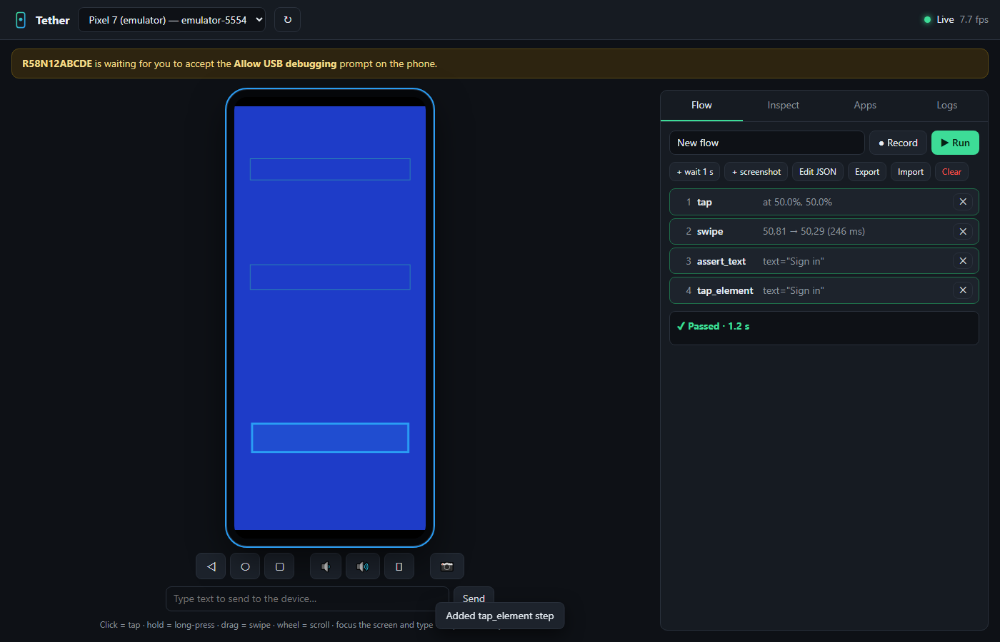
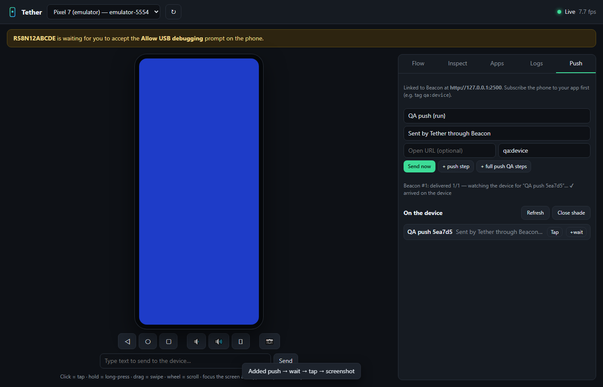

# Tether

**Stream and drive Android phones and emulators from your browser — record QA flows, replay them in CI, and let AI agents test your apps.**

A Windows-friendly, zero-dependency take on the idea behind
[TapFlow](https://github.com/jo-duchan/tapflow) (which streams iOS/Android
simulators from a Mac). Tether needs only **Python 3 + adb**, so it runs on the
same Windows PC you build your Capacitor apps on (Vitals, Glow, Airiz, Guangyao…).



| | |
| --- | --- |
| **Live screen** | Click = tap, hold = long-press, drag = swipe, wheel = scroll, type straight into the device, hardware keys, screenshot download |
| **Flows** | Record what you do → JSON flow → replay on any phone (coordinates are normalised). Add `tap_element` / `assert_text` steps from the inspector — they survive layout changes |
| **Inspect** | Reads the live UI tree (uiautomator), draws element boxes over the screen, one-click tap / +step / +assert |
| **Apps** | Drag-drop an APK anywhere to install; launch / stop / clear data |
| **Logs** | logcat, optionally only from one app's process, with highlight (e.g. `FATAL`) and live refresh |
| **Team sharing** | `--lan` lets teammates on your network open the same device (token-protected) |
| **AI agents (MCP)** | `mcp_server.py` gives Claude / Cursor / VS Code / OpenCode agents `screenshot`, `ui_elements`, `tap_element`, `type_text`, `logcat`, `run_flow`, … |
| **CI** | `flows.py run flow.json` → exit 0/1, `report.json` + screenshots |

## Quick start

```bash
python apps/pushlab/tether/server/server.py          # opens http://127.0.0.1:8765/#token=…
python apps/pushlab/tether/server/server.py --lan    # share with your team on the LAN
```

- **No adb?** Tether shows **Install it for me**: a one-time ~7 MB download of Google's Platform-Tools into `apps/pushlab/tether/tools/`. It works through corporate proxies and doesn't need admin rights or PATH changes. (Command-line equivalent: `python apps/pushlab/tether/server/adb_setup.py`.)
- **Phone:** *Settings → About → tap Build number 7×*, then *Developer options → USB debugging*. Plug it in and accept the prompt.
- **No cable:** click **📶 Wi-Fi** and type the pairing address and 6-digit code from *Developer options → Wireless debugging → Pair device with pairing code* (Android 11+).
- **With Beacon:** use `apps/pushlab/start-push-lab.bat` instead. It starts both apps already linked (see [../README.md](../README.md)).

## Flows

```json
{
  "name": "login smoke",
  "steps": [
    {"action": "clear_data", "package": "com.example.app"},
    {"action": "launch", "package": "com.example.app"},
    {"action": "wait_for", "text": "Sign in", "timeout_ms": 10000},
    {"action": "tap_element", "resource_id": "email"},
    {"action": "text", "text": "qa@example.com"},
    {"action": "tap_element", "text": "Sign in"},
    {"action": "assert_text", "text": "Dashboard"},
    {"action": "screenshot", "name": "dashboard"}
  ]
}
```

Actions: `launch`, `stop`, `clear_data`, `tap`, `long_press`, `swipe`, `text`, `key`,
`tap_element`, `wait_for`, `assert_text`, `assert_gone`, `wait`, `screenshot`.
`tap`/`swipe` use normalised `x`,`y` (0–1). Element steps match `text`, `resource_id`
(full or short) or `desc`.

```bash
python apps/pushlab/tether/server/flows.py run apps/pushlab/tether/examples/smoke.tether.json --out reports/
```

## Maestro flows

Tether reads and writes [Maestro](https://github.com/mobile-dev-inc/maestro) (Apache-2.0) YAML, so existing
`maestro test` suites run in the browser and Tether flows can go back to Maestro:

- Flow tab → **Import** accepts `.yaml`; **Export Maestro** downloads one.
- `python server/flows.py run login.yaml` runs a Maestro file directly (exit code 0/1 for CI).
- `python server/flows.py convert login.yaml login.json` (or the other way round).
- MCP `run_flow` accepts `maestro_yaml`.

Supported: `launchApp` (clearState/stopApp), `stopApp`, `clearState`, `tapOn` / `longPressOn` / `doubleTapOn`
(text, id, `point` in %), `inputText`, `eraseText`, `pressKey`, `back`, `hideKeyboard`, `assertVisible`,
`assertNotVisible`, `extendedWaitUntil`, `swipe` (direction or start/end %), `scroll`, `scrollUntilVisible`,
`takeScreenshot`, `openLink`, `waitForAnimationToEnd`, `assertWithAI` / `assertNoDefectsWithAI` (→ `ai_assert`),
`optional: true`. Text selectors match the visible text first, then the accessibility label, like Maestro. Anything else (`runFlow`, `repeat`,
`evalScript`, absolute pixel points, relative selectors…) is reported as a warning, never silently dropped.
Tether-only steps (Beacon push, notifications) export as `# tether:` comments.

## Midscene scripts

[Midscene.js](https://github.com/web-infra-dev/midscene) (MIT) YAML scripts — `android:` / `web:` target plus
`tasks:` with natural-language steps — import the same way (Flow tab → **Import**, `flows.py run script.yaml`,
`POST /api/flow/midscene/import`, MCP `run_flow` with `yaml`). Tether's own AI steps do the vision work, so any
OpenAI-compatible model or ARTEMIS runs them:

| Midscene | Tether |
| --- | --- |
| `aiAct` / `aiAction` / `ai`, `aiTap`, `aiDoubleClick`, `aiLongPress`, `aiInput` | `ai` with a goal |
| `aiAssert` (+ `errorMessage`) | `ai_assert` |
| `aiWaitFor` (+ `timeout`) | `ai_assert` retried until `timeout_ms` |
| `aiKeyboardPress`, `aiScroll` | `key`, `swipe` |
| `sleep`, `launch`, `terminate`, `recordToReport` | `wait`, `launch` / `open_url`, `stop`, `screenshot` |
| `continueOnError: true` | the task's steps become `optional` |

`aiQuery`/`aiBoolean`/… (data extraction), `aiHover`, `runAdbShell` and `javascript` are reported as warnings and
not run — scripts never get a shell on the phone through Tether.

## One flow on every phone

The device-farm idea of [STF](https://github.com/DeviceFarmer/stf) / [lamda](https://github.com/firerpa/lamda),
without the farm: run a flow on every connected device at once, one report per device.

```bash
python server/flows.py run smoke.json --all --out reports/   # reports/<serial>/report.json + matrix.json
```

Also `POST /api/flow/run-all {flow | yaml, serials?}`, MCP `run_flow` with `all_devices: true`, and
`pushlab_cli.py flow smoke.json --all-devices`. A device that disconnects fails alone; the others keep going.

## HD mode (scrcpy)

The **HD** button under the screen switches from PNG screenshots (~2-8 fps) to a 30 fps H.264 stream from
[scrcpy](https://github.com/Genymobile/scrcpy)'s device server (Apache-2.0, v5.0.1, downloaded once, SHA-256
checked, 734 KB). The browser decodes it with WebCodecs (Chrome/Edge, Firefox 130+), and taps, swipes, keys and
text go through scrcpy's control socket instead of `adb shell input` — milliseconds instead of a few hundred.
Turning HD off (or any error) falls back to screenshots and adb input. API: `/api/hd/start`, `/api/hd/stop`,
`/api/hd/status`, `/api/hd/stream`.

## Screen recording

The **⏺** button next to HD records the screen:

- **HD on** — the browser records the decoded video itself (MediaRecorder on the canvas, WebM, exactly what you see).
- **HD off** — the phone records with `adb screenrecord` (MP4, max 180 s, no audio) and Tether downloads it when you
  click **⏹**. API: `POST /api/record/start` `{serial, time_limit}`, `POST /api/record/stop`, `GET /api/record/file`.

`GET/POST /api/clipboard` reads or sets the phone's clipboard through scrcpy's control channel (works even when
HD is off; plain adb can't reach the clipboard on Android 10+).

## AI steps (optional)

Two flow steps hand a goal or a check to a model — any OpenAI-compatible endpoint, local by default:

```json
{"action": "ai", "goal": "Sign in as qa@example.com with password hunter2", "max_steps": 10}
{"action": "ai_assert", "condition": "The dashboard shows a balance in euros"}
```

| Variable | Default | |
| --- | --- | --- |
| `TETHER_AI_URL` | `http://127.0.0.1:11434/v1` | Ollama; LM Studio is `http://127.0.0.1:1234/v1`, OpenAI `https://api.openai.com/v1` |
| `TETHER_AI_MODEL` | `qwen2.5vl:7b` | a vision model works best |
| `TETHER_AI_KEY` | — | sent as `Authorization: Bearer` |
| `TETHER_AI_VISION` | `1` | `0` sends only the element list (text-only models) |

The model sees a numbered list of on-screen elements (and a 768 px screenshot) and answers with one JSON action
at a time (`tap`, `type`, `swipe`, `key`, `done`, `fail`); invented element numbers are rejected, `max_steps`
caps the loop, and the report lists every action taken. Nothing is sent anywhere unless a flow contains one of
these steps. Prefer normal steps for anything deterministic — AI steps are for fuzzy goals and visual checks.

**ARTEMIS engine.** For harder, multi-app goals, the same steps can run on
[google/artemis](https://github.com/google/artemis) (Apache-2.0; Flash and Pro agents, 99%+ on AndroidWorld).
Start ARTEMIS its own way (`start.bat` / `uv run artemis`, with its own model keys), then add
`"engine": "artemis"` to a step — or set `TETHER_AI_ENGINE=artemis` for all of them:

```json
{"action": "ai", "engine": "artemis", "goal": "Book the 9:00 slot for tomorrow", "profile": "pro", "app": "com.example.clinic"}
{"action": "ai_assert", "engine": "artemis", "condition": "The booking confirmation shows 9:00"}
```

Tether talks to the ARTEMIS daemon with a standard-library port of its `artemis-client` HTTP protocol
(`ARTEMIS_BASE_URL`, default `http://127.0.0.1:8000`; `ARTEMIS_TOKEN`), so nothing extra is installed in Tether.
`profile` is `flash` (fast) or `pro` (plan → act → verify), `app` keeps the agent inside one package and
`timeout_s` stops the remote task when exceeded. `ai_assert` asks ARTEMIS to only look and answer PASS/FAIL.
From a shell: `pushlab_cli.py ai "goal" --engine artemis --profile pro` or `pushlab_cli.py ai "condition" --check`.
Turn Tether's HD mode off while ARTEMIS drives the phone — both want the device's scrcpy session.

## Performance (startup, memory, jank, CPU)

The metric set of [SoloPi](https://github.com/alipay/SoloPi)'s performance tools (Apache-2.0), measured from the
host with stock adb — nothing is installed on the phone:

| Metric | Source | Fields |
| --- | --- | --- |
| Startup | `am start -W` (`-S` = cold) | `total_ms` (median of runs), `launch_state` COLD/WARM/HOT |
| Memory | `dumpsys meminfo <pkg>` | `pss_mb`, `java_heap_mb`, `native_heap_mb`, `rss_mb` |
| Frames | `dumpsys gfxinfo <pkg> [reset]` | `frames`, `jank_percent`, `p50/p90/p95/p99_ms` |
| CPU | `/proc/stat` + `/proc/<pid>/stat` over a window | `percent` (of the device), `core_percent` (top-style) |

Budgets make them regression tests. `perf_reset` starts a fresh frame window, so the jank you assert is the
scenario's own, not the app's lifetime average:

```json
{"action": "perf_startup", "package": "com.example.app", "runs": 3, "max_ms": 1500}
{"action": "perf_reset", "package": "com.example.app"}
{"action": "scroll_until_visible", "text": "Load more"}
{"action": "perf_assert", "package": "com.example.app", "max_jank_percent": 10, "max_p90_ms": 24, "max_pss_mb": 250}
```

Also available as `GET /api/perf`, `POST /api/perf/startup`, `POST /api/perf/reset`, the MCP tools
`perf_snapshot` / `perf_startup`, and `pushlab_cli.py perf <package> [--startup] [--reset] [--max-jank 10 ...]`
(exit 1 when over budget). Numbers from emulators are only good for trends; judge budgets on real devices.

### Perfetto traces

When a budget fails you want to know *why*. Tether records [Perfetto](https://perfetto.dev) (Apache-2.0) system
traces with the `perfetto` binary that ships with Android 9+ (scheduling, CPU frequency, frames, binder, the
app's atrace markers) and pulls the `.pftrace` to `tether/reports/` (or `TETHER_REPORTS_DIR`). Open it in
[ui.perfetto.dev](https://ui.perfetto.dev) — it loads locally in the browser.

```json
{"action": "perf_trace_start", "package": "com.example.app", "keep": "on_fail"}
{"action": "scroll_until_visible", "text": "Load more"}
{"action": "perf_assert", "package": "com.example.app", "max_jank_percent": 10}
```

`keep: "on_fail"` keeps the trace only when the flow fails (evidence, not clutter); a trace still running at the
end of a flow is always stopped. `perf_trace_stop` stops and pulls explicitly; `perf_startup` takes `"trace": true`.
Also `POST /api/perf/trace/start|stop`, `GET /api/perf/trace/file`, MCP `perf_trace`, `pushlab_cli.py trace start|stop`.

### Memory leaks (LeakCanary)

If the app's debug build includes [LeakCanary](https://square.github.io/leakcanary) (Apache-2.0), Tether reads its
heap-analysis results from logcat and turns them into assertions — nothing extra on the phone:

```json
{"action": "leak_mark"}
{"action": "tap_element", "text": "Settings"}
{"action": "key", "key": "back"}
{"action": "assert_no_leaks", "wait_ms": 20000}
```

`assert_no_leaks` fails with the leaking classes (e.g. `com.example.LoginActivity`) and retained bytes;
`include_library: true` also counts known library leaks, `require_analysis: true` fails when LeakCanary logged
nothing. Also `GET /api/leaks`, MCP `leak_report`, `pushlab_cli.py leaks --max 0`.

## CI on an emulator

[`examples/ci/android-emulator.yml`](examples/ci/android-emulator.yml) is a GitHub Actions template that boots an
emulator with [ReactiveCircus/android-emulator-runner](https://github.com/ReactiveCircus/android-emulator-runner)
and runs your flows (JSON or Maestro YAML) with `flows.py run`, uploading screenshots and reports.

## AI agents (MCP)

Add to your MCP client config (Claude Desktop, Cursor, VS Code, OpenCode…):

```json
{
  "mcpServers": {
    "tether": {
      "command": "python",
      "args": ["C:/Users/you/projects/apps/pushlab/tether/server/mcp_server.py"]
    }
  }
}
```

Then ask: *"Install app-debug.apk, open it, sign in as qa@example.com and tell me if anything crashes in logcat."*
Screenshots are downscaled on the host (~1024 px) to keep agent context small; `tap`
coordinates default to the screenshot's pixel space.

**mobile-mcp compatible.** The same server also speaks the tool names and arguments of
[mobile-next/mobile-mcp](https://github.com/mobile-next/mobile-mcp) (Apache-2.0), so prompts and skills written
for it work unchanged — with plain adb, no Node or WebDriverAgent: `mobile_list_available_devices`,
`mobile_list_elements_on_screen` (with `@eN` refs), `mobile_click_on_screen_at_coordinates` (x/y or `ref`),
`mobile_double_tap_on_screen`, `mobile_long_press_on_screen_at_coordinates`, `mobile_swipe_on_screen`,
`mobile_type_keys`, `mobile_press_button`, `mobile_open_url`, `mobile_launch_app` (with `locale`),
`mobile_terminate_app`, `mobile_clear_app_data`, `mobile_install_app`, `mobile_uninstall_app`, `mobile_list_apps`,
`mobile_get_foreground_app`, `mobile_get_screen_size`, `mobile_take_screenshot`, `mobile_save_screenshot`,
`mobile_get_orientation` / `mobile_set_orientation`, `mobile_set_location` (emulators), `mobile_clipboard`
(via scrcpy), `mobile_get_device_logs` (filters like `level=Error`, `process=com.app`), `mobile_list_crashes` /
`mobile_get_crash` (logcat crash buffer), `mobile_start_screen_recording` / `mobile_stop_screen_recording` and
`mobile_batch_commands`. Android only; device logs return the newest buffered entries rather than waiting for new
ones. Clients with a tool limit can pick a set: `mcp_server.py --tools mobile` (or `tether`, default `all`).

**Agent skills.** [`apps/pushlab/plugin`](../plugin) packages Tether + Beacon as Agent Skills (SKILL.md)
with a zero-dependency CLI — install in Claude Code with `/plugin marketplace add juw12/projects`.

## Push QA with Beacon

Tether and [Beacon](../beacon) work together: Beacon **sends** the notification, Tether **proves it arrived** on a real phone, taps it and checks where it leads. They stay separate servers on purpose. Beacon is public and always on behind HTTPS. Tether controls USB devices and should stay on your machine.

```bash
python apps/pushlab/tether/server/server.py --beacon-url https://push.example.com --beacon-key sk_…
# or locally: apps/pushlab/start-push-lab.bat sk_…
```

1. In the **Push** tab, click **📲 Connect this phone to Beacon** (or put a `beacon_subscribe` step first in your flow). To test your own PWA instead, subscribe from it with `Beacon.subscribe({ tags: ["qa:device"] })`.
2. In Tether's **Push** tab, click **Send now** to see the delivery and arrival check, or click **+ full push QA steps**.
3. Save the flow and run it in CI: `python apps/pushlab/tether/server/flows.py run apps/pushlab/tether/examples/push-qa.tether.json`.

| Step | |
| --- | --- |
| `push` | send through Beacon. Fails if no subscriber matched or Beacon delivered to 0 |
| `wait_notification` | the notification must appear on the device (`dumpsys notification`), optionally from a given `package` |
| `tap_notification` | open the shade and tap it |
| `close_notifications` | collapse the shade |
| `beacon_subscribe` | open Beacon's subscribe page on the phone and tap *Enable* + *Allow*. A local Beacon is reached through `adb reverse`, so no HTTPS is needed |

`{run}` in any step becomes a fresh id per run, so a test never passes because of yesterday's notification. AI agents get the same tools through Tether's MCP server: `send_push`, `list_notifications` and `tap_notification`.



## Security

- Every `/api` call needs the access token (printed at start-up, passed in the URL `#fragment`).
- Local mode binds `127.0.0.1` and rejects foreign `Host` headers (DNS-rebinding protection).
- `--lan` binds all interfaces: **anyone with the link controls the device** — share it like a password.
- Package names are validated; text input is shell-escaped; uploads must be real APKs.

## Limits

- Without HD, frames are PNG screencaps (~3–8 fps on USB, slower over Wi-Fi adb). Turn on HD for 30 fps.
- `input text` is ASCII only (Android limitation); for other scripts, paste via the device keyboard.
- No audio, no multi-touch gestures (pinch).
- Android only — iOS simulators need a Mac (that's TapFlow's niche).

## Layout

```
apps/pushlab/tether/
  server/adb.py         adb wrapper (shared by everything)
  server/server.py      HTTP API + frame hub + static web UI
  server/flows.py       flow runner + CLI
  server/mcp_server.py  MCP stdio server for AI agents
  server/mobile_compat.py  mobile-mcp compatible tools
  server/maestro.py     Maestro YAML import/export
  server/scrcpy.py      HD mode: scrcpy video + control (+ clipboard)
  server/ai.py          optional AI steps (OpenAI-compatible endpoint)
  server/artemis.py     optional ARTEMIS engine for AI steps (HTTP client, stdlib)
  server/perf.py        startup / memory / frames / CPU budgets, Perfetto traces, LeakCanary results
  server/midscene.py    Midscene YAML import
  web/                  static UI (no build step)
  tests/                hermetic tests with a fake adb
  examples/             sample flows
```

## Tests

```bash
python apps/pushlab/tether/tests/verify_api.py            # 65 checks, no device needed
python apps/pushlab/tether/tests/verify_beacon_link.py    # 30 checks: real Beacon → encrypted push → fake phone → tap
python apps/pushlab/tether/tests/verify_maestro.py        # Maestro YAML import/export (62)
python apps/pushlab/tether/tests/verify_hd.py --browser   # scrcpy protocol + WebCodecs + recording in headless Edge
python apps/pushlab/tether/tests/verify_mobile_mcp.py     # mobile-mcp tools, recording, clipboard (52)
python apps/pushlab/tether/tests/verify_ai.py             # AI steps against a fake OpenAI-compatible server (26)
python apps/pushlab/tether/tests/verify_artemis.py        # ARTEMIS engine against a fake ARTEMIS daemon (18)
python apps/pushlab/tether/tests/verify_perf.py           # startup / memory / jank / CPU parsers, flows, API, MCP (39)
python apps/pushlab/tether/tests/verify_deep.py           # Perfetto, LeakCanary, multi-device runs, Midscene (124)
```
