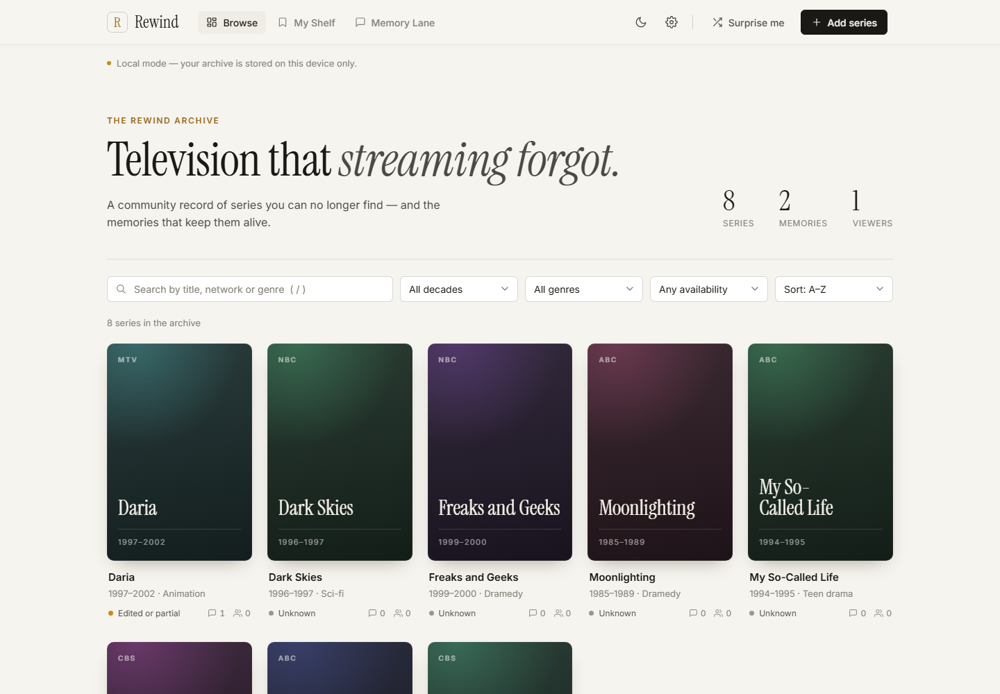

# Rewind — remember the shows streaming forgot

A community archive for old TV series that are hard to find on today's streaming
platforms: share memories and quotes, keep a personal shelf, and track where (if
anywhere) a show can still be watched. Runs in any browser and installs on phones as an
app (PWA).

**Live:** https://juw12.github.io/projects/rewind/ (local mode — data stays in your browser)



## Features

- **Browse** the archive as poster tiles; search, filter by decade and availability, sort.
- **Series pages** (slide-in panel) with memories, quotes, "I remember this" counts and a
  community availability status (not streaming / partial / physical media only / streaming).
- **My Shelf** for favourites and **Memory Lane**, a feed of the latest memories.
- **Settings**: theme (System / Light / Dark), accent colour, text size, card density,
  reduce motion, display name, start page, default sort, hide series already streaming,
  export / import / reset the archive, keyboard shortcuts.
- **Day / night mode** with a quick toggle in the top bar; *System* follows the OS live.
- **Shareable links** for every page and series (`#/browse`, `#/shelf`, `#/feed`,
  `#/settings`, `#/show/<id>`); the back button closes panels.
- Installable PWA with an offline app shell; offline / online notices.

## Two modes

| Mode | When | Data |
|------|------|------|
| **Local** | `web/config.js` left empty (default, used by the live demo) | Saved in this browser only. Export/Import backup in Settings. |
| **Online** | Supabase URL + key filled in `web/config.js` | Shared by everyone. Email magic-link sign-in, live Memory Lane feed. |

If the Supabase library can't load within 10 s, the app falls back to local mode and
says so, instead of hanging.

### Go online (free Supabase tier)

1. Create a project at <https://supabase.com>.
2. *SQL Editor → New query*: paste all of `supabase/schema.sql` and run it (tables,
   row-level security, realtime and 8 starter shows).
3. *Project Settings → API*: copy the Project URL and the anon / publishable key into
   `web/config.js`.
4. Host `web/` on any static host, then add the site URL under
   *Authentication → URL Configuration* (Site URL + Redirect URLs).

Security rules: anyone can read; only signed-in users can post, and only as themselves;
people delete only their own posts; shelves are private; text lengths are capped and
duplicate titles rejected.

## Layout

```
apps/rewind/
  web/                 the app (static: index.html, styles.css, app.js, store.js,
                       settings.js, config.js, manifest.webmanifest, sw.js, icons/)
  supabase/schema.sql  online-mode database setup
  tests/               hermetic stdlib checks (run by scripts/run_all_tests.py)
  ui-tests/            browser suite (headless Edge, 43 checks) + screenshot capture
  docs/                PLAN.md (v1.1 plan) and screenshots/
```

Run the browser suite on Windows (needs Edge and Python):

```
cd apps/rewind
powershell -ExecutionPolicy Bypass -File ui-tests\run-ui-tests.ps1
```

## Status and limits

Working prototype (v1.1.0). Online mode has not yet been tested against a live Supabase
project. Before a public launch it needs moderation (report button, admin role), a
custom SMTP sender for sign-in mail, a privacy policy and content terms. No posters are
included for copyright reasons; generated colour tiles are used instead. Availability
is community-reported and varies by country.
