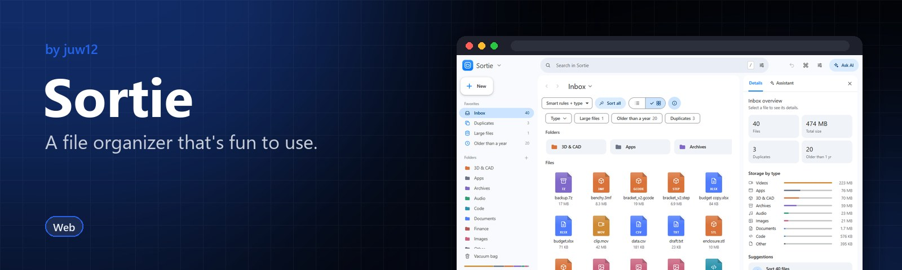
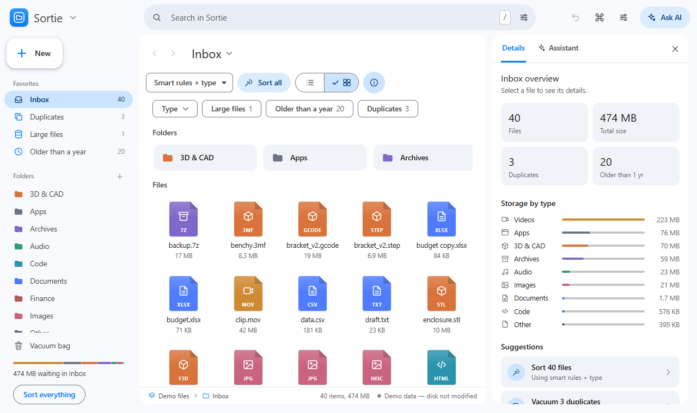

<!-- HERO:START -->

  

  <b>A file organizer that's fun to use.</b> 
  Sorted files fly into their folders and a vacuum sucks deletes into a recoverable bag.

  <a href="https://juw12.github.io/projects/sortie/"><b>Try it live</b></a> ·
  <a href="#see-it-in-action">See it in action</a> ·
  <a href="#highlights">Highlights</a> ·
  <a href="https://github.com/juw12">More by juw12</a>

  
  
  
  

<table>
  <tr>
    <td width="33%" valign="top">
      <b>Animated sorting</b> 
      Watch files fly into the right folders.
    </td>
    <td width="33%" valign="top">
      <b>Recoverable deletes</b> 
      The Vacuum bag keeps everything until you empty it, and every action is undoable.
    </td>
    <td width="33%" valign="top">
      <b>Plain-words assistant</b> 
      Ask in plain words; the AI shows a plan you Run or Cancel.
    </td>
  </tr>
</table>

## See it in action

   
  Open the interactive demo at <a href="https://juw12.github.io/projects/sortie/">juw12.github.io/projects/sortie/</a>

<!-- HERO:END -->

## About

A file organizer with animated sorting, a recoverable delete ("Vacuum bag") and a built-in assistant.

## Run
- **Live:** https://juw12.github.io/projects/sortie/ (demo data loads by default; nothing touches your disk until you open a folder).
- **Desktop:** open `web/index.html` in Chrome or Edge. Use **File → Open folder**, or drag a folder in from Explorer, to work on real files.
- **Phone:** open the live link, then choose *Add to Home screen*. Phone browsers are preview-only.

## Layout
A Google Drive x macOS Finder hybrid:
- **Sidebar (Finder):** workspace menu, Drive-style **New** button, Favorites (All files, Duplicates, Large files, Older than a year), Folders with counts, colour Tags, Vacuum bag, storage meter and **Sort everything**. Folders are drop targets, and sorted files fly into them.
- **Top bar (Drive):** pill search with a filter menu, Undo, Command palette, Settings, Ask AI.
- **Content card:** Back / Forward, page title menu, Sort, a List / Grid toggle and Details. Below that are Drive filter chips (Type, Large, Old, Duplicates), or a selection bar (Sort, Move, Rename, Vacuum, More) while files are selected. There's a strip of suggested folders, then Finder icon view (grey halo + blue name pill on selection) or striped list view (Name / Date Modified / Size / Kind).
- **Path bar (Finder):** location breadcrumb, item / selection counts and the data source.
- **Right panel:** Details inspector and Assistant tabs. On phones the sidebar becomes a drawer and the panel a bottom sheet.
- **Navigation:** Alt+Left / Alt+Right or Ctrl+[ / Ctrl+] for back and forward.

## Features
- **Menu bar:** File, Edit, View, Sort and Help. On a phone, these open from the menu button.
- **Context menus:** right-click (or long-press) a file or folder.
- **Command palette:** Ctrl+K.
- **Search and filters:** search box plus quick filters for Images, Documents, Media, 3D / CAD, Large, Older than 1 yr, Duplicates and Selected.
- **View options:** grid or list, card size, sort order, animation speed, dark / light / system theme, accent colour.
- **Dialogs:** file preview, batch rename with live preview, smart-rule editor, settings.
- **Drag and drop:** drag files onto folders, the Vacuum bag, or "New folder".
- **Undo:** Ctrl+Z, from the notification, or from the assistant.

## Assistant
Open it with the Assistant button or Ctrl+J and describe what you want, for example:
"vacuum duplicates", "put all CAD files into Projects", "always put invoices in Finance",
"add date to photo names", "delete screenshots older than 30 days", "what's taking up space?".

The assistant shows a plan listing the affected files. Any move, rename or delete waits until you click **Run**, and can be undone.

**Engines** (Assistant → options → Assistant settings):
- **Built-in helper:** offline, no API key.
- **OpenAI, Anthropic, Google Gemini, OpenRouter, Groq:** use your own API key. "Load models" lists the models currently available.
- **Ollama, LM Studio:** local models. Ollama needs `OLLAMA_ORIGINS=*` so the browser can reach it.

**Privacy:** online providers receive file names, sizes and dates only, never file contents. API keys are stored only in this browser.

## Safety
- Deleted files go to `_Vacuum bag`. They are only removed permanently by **Empty**, which asks for confirmation.
- Demo and preview modes never modify the disk.
- Moving and renaming real files requires Chrome or Edge on desktop. Phone browsers are preview-only.

## Code layout
`css/app.css` · `js/icons.js` (SVG icon set) · `js/core.js` (data, settings, disk, sound) · `js/effects.js` (animations) · `js/ui.js` (cards, menus, dialogs, drag & drop) · `js/layout.js` (sidebar, folder pages, inspector, panel, status bar) · `js/ops.js` (sort, vacuum, rename, undo, loading) · `js/assistant.js` (chat, offline parser, AI providers, plans) · `js/main.js` (wiring)
