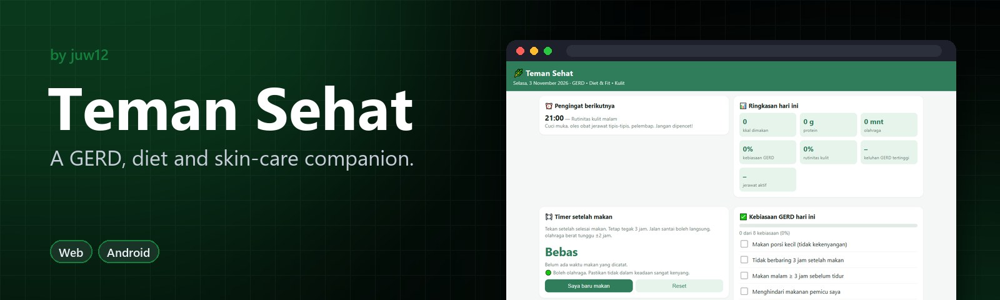
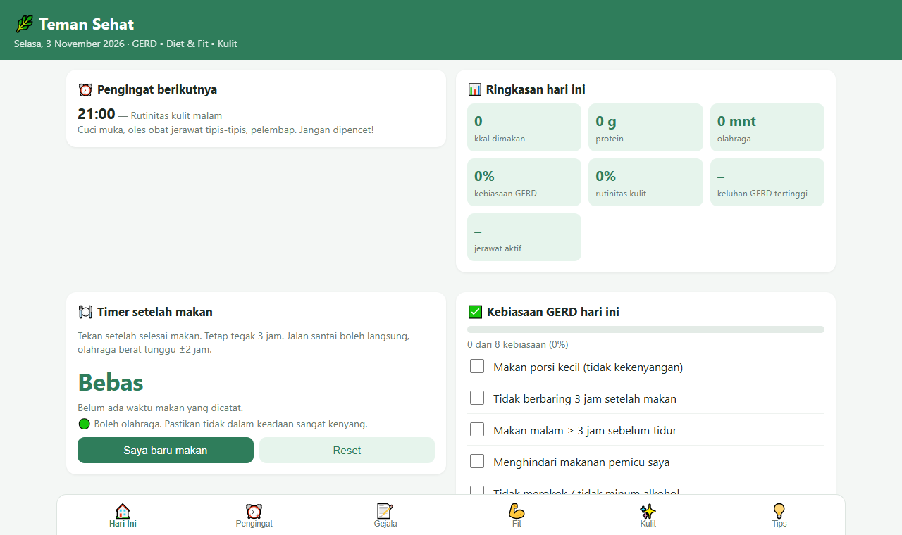

<!-- HERO:START -->
<p align="center">
  <a href="https://juw12.github.io/projects/teman-sehat/"></a>
</p>

<p align="center">
  <b>A GERD, diet and skin-care companion.</b><br>
  Daily reminders, an after-meal timer and a symptom log, in Bahasa Indonesia and English.
</p>

<p align="center">
  <a href="https://juw12.github.io/projects/teman-sehat/"><b>Try it live</b></a> ·
  <a href="#see-it-in-action">See it in action</a> ·
  <a href="#highlights">Highlights</a> ·
  <a href="https://github.com/juw12">More by juw12</a>
</p>

<p align="center">
  <a href="https://github.com/juw12/projects/tree/main/apps/teman-sehat"></a>
  <a href="https://juw12.github.io/projects/teman-sehat/"></a>
  
  
  
</p>

<a id="highlights"></a>
<table>
  <tr>
    <td width="33%" valign="top">
      <b>GERD habits</b><br>
      Daily reminders, an after-meal timer and a symptom and trigger log.
    </td>
    <td width="33%" valign="top">
      <b>Diet and fitness without fasting</b><br>
      Plans that are gentle on the stomach.
    </td>
    <td width="33%" valign="top">
      <b>Acne care</b><br>
      A skin routine and acne tracking in the same app.
    </td>
  </tr>
</table>

## See it in action

<p align="center">
  <a href="https://juw12.github.io/projects/teman-sehat/"></a><br>
  <sub>Open the interactive demo at <a href="https://juw12.github.io/projects/teman-sehat/">juw12.github.io/projects/teman-sehat/</a></sub>
</p>
<!-- HERO:END -->

## About

A lifestyle companion for people with GERD, in Bahasa Indonesia. It combines GERD habit reminders,
dieting and fitness without fasting, and acne care in one offline app. Data stays on the device.

- **Hari Ini:** next reminder, a daily summary (kcal, protein, exercise, GERD habits, skin routine,
  symptoms, pimples), a meal timer ("stay upright for 3 h, hard exercise after about 2 h"),
  a GERD habit checklist and a 7-day chart.
- **Pengingat:** daily reminder schedule (GERD, exercise, morning/night skin routine); add, edit,
  turn off or delete reminders.
- **Gejala:** a GERD symptom log with triggers, plus a 30-day ranking of likely triggers.
- **Fit:** calorie and protein targets (Mifflin–St Jeor, Asian BMI cut-offs, a calorie floor), split
  into 5 small meals; a food log with GERD-friendly Indonesian foods (trigger foods marked ⚠️);
  an exercise log against 150 min cardio + 2–3 strength days; a weight chart with a goal line;
  and a guide to dieting without fasting.
- **Kulit:** a morning/night skin routine checklist, a 14-day pimple counter, and a guide covering
  actives, what to avoid (including non-BPOM creams), diet links (whey, high-GI foods), the
  doxycycline/GERD warning, and when to see a skin doctor.
- **Tips:** GERD lifestyle advice and warning signs that need a doctor.

Not medical advice: the app is a reminder and lifestyle guide, not a substitute for a doctor,
skin doctor or dietitian.

## Run / install

| Platform | How |
|---|---|
| Web | https://juw12.github.io/projects/teman-sehat/ (sample data: `#demo`) |
| Desktop (Windows/Mac/Linux) | Open the link in Edge/Chrome → *Install* icon in the address bar. Offline: `desktop/Buka-Aplikasi-Desktop.cmd` serves `web/` on localhost. |
| Android | Chrome → ⋮ → *Install app* |
| iPhone | Safari → Share → *Add to Home Screen* (notifications need iOS 16.4+) |
| Native iOS/Android | `mobile/`: Capacitor shell around `../web` with native daily reminders |

Installed web apps only send reminders while they are open. The native build schedules every
reminder (and the 2 h / 3 h meal alerts) as OS local notifications, so they fire with the app closed.

### Native build (`mobile/`)

Needs Node.js 22+, Android Studio (Android) and a Mac with Xcode (iOS).

```bash
cd apps/teman-sehat/mobile
npm install
npx cap add android && npx cap add ios
npm run icons
npx cap sync
npx cap open android   # or: npx cap open ios
```

For exact reminder times on Android 12+, add
`<uses-permission android:name="android.permission.SCHEDULE_EXACT_ALARM" />` to
`android/app/src/main/AndroidManifest.xml`, then run `npx cap sync` again.

## Test

```bash
python apps/teman-sehat/tests/verify_web.py
```

## Layout

- `web/`: the whole app (`index.html`), `manifest.webmanifest`, `sw.js` (offline cache), icons
- `mobile/`: Capacitor config + 1024 px source icon
- `desktop/`: local launcher for installing on Windows without hosting
- `tests/verify_web.py`: stdlib checks (files, manifest, ids, HTTP, wrappers)

When you change `web/`, bump `CACHE_NAME` in `web/sw.js` so installed copies update.
