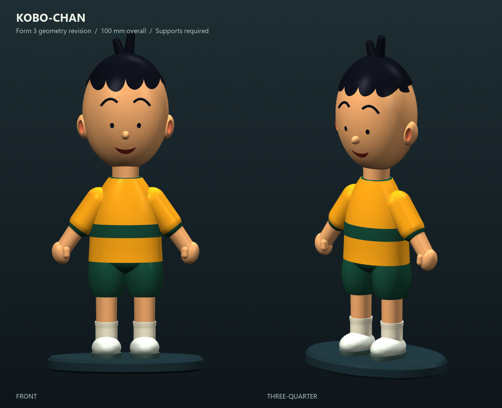

# Kobo-chan — Formlabs Form 3 geometry revision

**Status: geometrically checked model, not a validated PreForm print job.**

[Download the complete package](kobochan_form3_package.zip) · [Upright STL](kobochan_form3_100mm.stl) · [STEP](kobochan_form3_100mm.step)

This is an unofficial, stylized interpretation of Kobo-chan, not a scan or an exact replica. The standing figure is 100 mm tall including its base. The model is supplied in millimetres.

## What changed

- Crown hair tips strengthened from 1.6 mm diameter to **2.4 mm diameter**; their roots are **3.2 mm diameter**. The taller tip is dimensioned to preserve the 100 mm overall height.
- Both shoes remain attached to the flat-bottom base. The nominal overall envelope is **46 mm wide, 32 mm deep, 100 mm tall**; the base is 4 mm thick.
- The figure remains **solid**. There are no enclosed hollow resin cavities; no drain holes are necessary for this solid version. The ear, eye and mouth recesses are open surface details.
- A second STL provides a **25-degree backward tilt** as a starting orientation, with the face turned slightly upward. It contains **no supports or raft**.

## Files

- `kobochan_form3_100mm.stl`: upright, single connected watertight mesh. Use this for your own orientation.
- `kobochan_form3_100mm_tilt25_unsupported.stl`: the same geometry, tilted backward by 25 degrees. This is only an orientation candidate, not a support-validated print file.
- `kobochan_form3_100mm.step`: colored, single-solid CAD interchange model. It does not contain a native Creo or SOLIDWORKS feature history.
- `kobochan_form3_preview.png`: front and three-quarter render. Colors are illustrative; the STL does not store colors.
- `build_kobochan.py`: editable OpenCASCADE generation script. Dependencies: cadquery-ocp, numpy, vtk, Pillow. Run it with Python; the default overall height is 100 mm.
- `form3_validation.json`: measured geometry, mesh, round-trip and build-envelope checks, including explicit checks that have not been performed.

## Required PreForm setup before printing

1. Select the **Form 3** and the **actual installed resin/tank configuration** in the current compatible PreForm release. The planning assumption here is standard **Grey Resin V4 / V4.1**, not an instruction to substitute that resin for what is loaded. Resin choice has not been confirmed by the owner.
2. Import one STL, in **mm**, without automatic rescaling. The upright model should be 100 mm high. The tilted STL has a different axis-aligned height but the same physical scale.
3. Use the tilted STL as a starting orientation, or choose your own after inspecting cross-sections. For this figurine, use an elevated, supported setup and a raft rather than assuming the flat base can be printed directly on the platform without distortion or removal damage.
4. Generate supports using the selected resin/profile defaults. Favor contact on the rear and underside, away from the face and visible fringe. Inspect the base, shoe edges, hands/thumbs, underside of sleeves, ears and chin. Add or move supports where needed; do not rely on an unsupported-STL file to include them.
5. Review PreForm's printability warnings and layer preview for unsupported islands, local minima, cups and collisions. A watertight mesh alone does not establish printability. The model fits the Form 3 build envelope, but **the final raft and support layout have not been checked**.
6. Select a layer height available for the actual resin profile. Finer layers can improve facial details. Wash, dry and post-cure using the current Formlabs instructions for that exact resin; this package does not prescribe unverified wash or cure settings.
7. Make a test print before treating this as a repeatable production setup. Remove supports carefully, especially around the hair, ears and fingers.

Do not hollow this model without adding and checking appropriate drain/vent paths and cleaning access.

## Checks performed

The generation script verifies one valid connected B-rep solid, one bounding shell, nominal height, STEP re-import validity and matching dimensions/volume, and an outward-oriented connected STL mesh with no boundary edges, non-manifold edges or degenerate triangles. It checks both STL orientations against the Form 3's nominal **145 × 145 × 185 mm** build envelope. It also exercises a 120% uniform height change and restores the requested dimensions before export.

The supplied report records the actual measured results. No supports, native PreForm job, resin-specific exposure setup, sliced-layer validation or physical print test have been completed. No production-readiness claim is made.

## Design guidance and references

Formlabs' Form 3 / Form 3B design guidance is based on **Clear Resin at 100 microns**, not a validation of this model in Grey Resin. Its published minimum details are general screening guidance, not guaranteed success for every geometry or resin. The crown dimensions in this revision are intentionally more substantial than the guide's slender-wire examples.

- Form 3 / Form 3B design specifications: https://formlabs.com/support/Design-specifications-for-3D-models-form-3/
- SLA orientation practices: https://formlabs.com/support/Model-Orientation/
- Grey Resin V4.1 compatibility: https://formlabs.com/global/products/grey-resin-v4-1/
- Formlabs build-volume guidance: https://formlabs.com/global/support/What-is-the-largest-part-I-can-print-on-a-Formlabs-printer/

Character/shape references:

- Eiken official Kobo-chan page: https://eiken-anime.jp/works/%E3%82%B3%E3%83%9C%E3%81%A1%E3%82%83%E3%82%93
- Japan Program Catalog: https://www.japan-programcatalog.com/en/program/kobochan
- Kobo-chan statue photographs: https://dragonflower.tokyo/kobo/

No reference photographs are redistributed in this package. Kobo-chan and its associated character rights belong to their respective owners; a repository code license does not grant rights to the underlying character.
